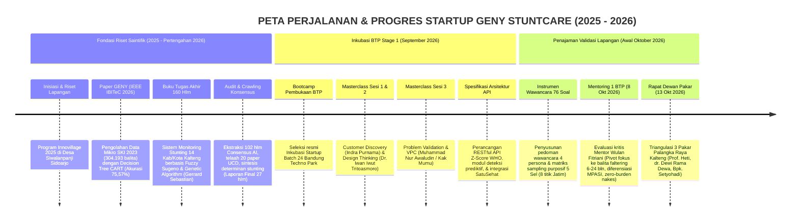
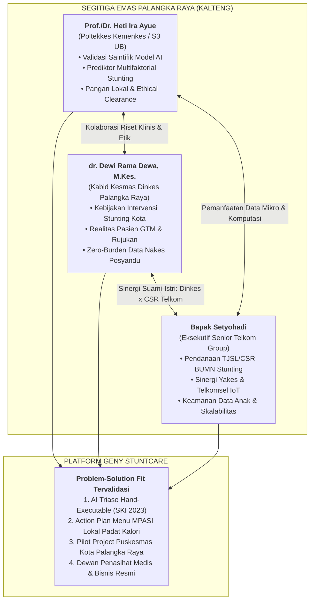

# 🎯 Master Panduan Strategis & Matriks Pertanyaan Rapat Dewan Pakar
## Konsultasi Tingkat Tinggi: Validasi Saintifik, Kebijakan Dinas Kesehatan & Scale-Up Korporat
### Startup Geny StuntCare — Program Inkubasi Bisnis Startup Batch 24 Bandung Techno Park (Telkom University)

---

<p align="center">
  
  
  
  
  
</p>

---

## 🗺️ 1. Peta Perjalanan & Riwayat Progres Proyek (*Project Trajectory Tracker*)

Sebelum melangkah ke sesi konsultasi dewan pakar, berikut adalah rekapitulasi komprehensif perjalanan riset, validasi, dan pengembangan teknologi **Geny StuntCare** sejak awal pembentukan hingga titik saat ini:



### Rekapitulasi Status Kesiapan Startup Saat Ini:
* **Status SRL (Startup Readiness Level):** Memasuki gerbang akhir **SRL-1 (Problem Validation)** menuju pengujian prototipe **SRL-2 (Solution Validation)**.
* **Aset Teknologi Aktif:** Platform web purwarupa ([genystuntcare.com](https://genystuntcare.com)), model komputasi CART Decision Tree (Paper IBITeC 2026), model Fuzzy Sugeno (Buku TA Kalteng), dan dokumen spesifikasi API.
* **Tantangan Validasi yang Sedang Diselesaikan:** Mengonfirmasi batasan klinis fenomena *weight faltering* balita usia 6–24 bulan, merumuskan formula intervensi gizi MPASI lokal, memastikan arsitektur *zero data-entry burden* bagi nakes, serta mengunci dukungan kemitraan pemerintah (Dinkes) dan korporasi (Telkom Group).

---

## 📌 2. Profil Mendalam & Rekam Jejak (*Track Record Dossier*) 3 Pakar Kunci

Pertemuan strategis pada **Selasa, 13 Oktober 2026** mempertemukan tim pendiri Geny StuntCare dengan tiga figur berpengaruh di **Kota Palangka Raya, Provinsi Kalimantan Tengah**. Ketiganya memiliki irisan riset, jabatan birokrasi, dan kepemimpinan industri yang sangat relevan:

```
┌────────────────────────────────────────────────────────────────────────────────────────────────────────┐
│                              DOSIR REKAM JEJAK & DINAMIKA STRATEGIS PANEL PAKAR                        │
├───────────────────────────────────┬───────────────────────────────────┬────────────────────────────────┤
│ Prof. / Dr. Heti Ira Ayue, S.ST., │ dr. Dewi Rama Dewa, M.Kes.        │ Bapak Setyohadi                │
│ M.Keb.                            │ (Istri dari Bapak Setyohadi)      │ (Suami dari dr. Dewi Rama D.)  │
├───────────────────────────────────┼───────────────────────────────────┼────────────────────────────────┤
│ JABATAN & INSTITUSI:              │ JABATAN & INSTITUSI:              │ JABATAN & INSTITUSI:           │
│ • Dosen Jurusan Kebidanan,        │ • Kepala Bidang Kesehatan         │ • Eksekutif Senior / Mantan    │
│   Poltekkes Kemenkes Palangka Raya│   Masyarakat (Kabid Kesmas),      │   Manager Marketing Telkom     │
│ • Lulusan Program Doktor (S3)     │   Dinas Kesehatan Kota Palangka   │   Kalimantan Timur & Tengah    │
│   Ilmu Kedokteran, Universitas    │   Raya                            │ • Tokoh Senior Manajemen Bisnis│
│   Brawijaya (UB) Malang           │ • Dokter Praktik Mandiri / Klinik │   & Kemitraan Telkom Group     │
│ • Pemohon Resmi Akses Data Mikro  │ • Tim Surveyor Akreditasi         │   Palangka Raya                │
│   SKI 2023 Kemenkes RI (Surat FK  │   Puskesmas Kemenkes RI           │                                │
│   UB No. 06361/2024)              │                                   │                                │
├───────────────────────────────────┼───────────────────────────────────┼────────────────────────────────┤
│ REKAM JEJAK RISET & KEPAKARAN:    │ REKAM JEJAK RISET & KEPAKARAN:    │ REKAM JEJAK RISET & KEPAKARAN: │
│ • Penulis Utama Paper Bereputasi  │ • Pemegang otoritas teknis &      │ • Berpengalaman puluhan tahun  │
│   Internasional (PubMed/Scopus):  │   anggaran program percepatan     │   dalam penetrasi pasar B2B &  │
│   "Exploring the multifactorial   │   penurunan stunting di seluruh   │   B2G telco/enterprise Kalteng │
│   predictors of stunting in       │   Puskesmas Kota Palangka Raya    │ • Paham struktur pendanaan     │
│   children under five" (2024)     │ • Menguasai sistem Posyandu ILP,  │   TJSL/CSR BUMN penanganan     │
│ • Pelopor program Kelompok        │   distribusi PMT, & alur rujukan  │   stunting serta ekosistem BTP │
│   Pendukung ASI (KP-ASI) & KIE    │ • Berhadapan langsung dengan ibu  │ • Menguasai tantangan jaringan │
│   Digital maternal di Kalteng     │   balita GTM di meja periksa      │   telekomunikasi 3T Kalteng    │
└───────────────────────────────────┴───────────────────────────────────┴────────────────────────────────┘
```

### 💡 Analisis Dinamika Khusus Pasangan Suami-Istri (dr. Dewi Rama Dewa & Bpk. Setyohadi):
Hubungan pernikahan antara **dr. Dewi Rama Dewa (Kabid Kesmas Dinkes Palangka Raya)** dan **Bapak Setyohadi (Senior Executive Telkom Group)** merupakan **kekuatan strategis luar biasa (*power-couple synergy*)** bagi Geny StuntCare:
1. **Sinergi Kebijakan Publik & Anggaran Korporat:** dr. Dewi memegang lokus masalah, data balita posyandu, dan kebutuhan faskes di lapangan, sementara Bapak Setyohadi memahami bagaimana korporasi telekomunikasi (Telkom TJSL/CSR) dapat mendanai program intervensi sosial melalui skema kemitraan resmi.
2. **Kredibilitas Ganda:** Rekomendasi medis dari dr. Dewi menjamin kepatuhan klinis Kemenkes, sedangkan restu bisnis dari Bapak Setyohadi memastikan arsitektur cloud, skalabilitas enterprise, dan keamanan data anak sesuai standar BUMN Telkom.
3. **Pintu Masuk Pilot Project:** Pasangan ini memiliki akses langsung untuk menyetujui dan memfasilitasi *pilot project* percontohan di salah satu Puskesmas percontohan Kota Palangka Raya (misal Puskesmas Pahandut, Jekan Raya, atau Menteng).

---

## 🧭 3. Arsitektur Triangulasi Strategis: "Segitiga Emas Palangka Raya"



---

## 🔬 4. Panduan Pertanyaan untuk Prof. / Dr. Heti Ira Ayue
*(POV: Akademisi Keperawatan Anak, Peneliti Utama Disertasi S3 UB, & Pakar Prediktor Multifaktorial Stunting)*

---

### KLASTER A: Validasi Saintifik Model Decision Tree (Paper GENY) & Data SKI 2023

#### ❓ Pertanyaan A.1: Resolusi Bobot Fitur vs Konsep Prediktor Multifaktorial
* **Redaksi Pertanyaan:**  
  *"Prof. Heti, dalam publikasi terbaru Ibu di Journal of Public Health Research (2024) yang mengulas 'Multifactorial predictors of stunting in children under five', Ibu menegaskan bahwa stunting dipicu oleh interaksi kompleks gizi, sanitasi, infeksi, dan pengasuhan. Namun, pada [Paper GENY](file:///Users/sinitygs/Projects21/05-laporan-data-crawling/03_referensi_utama_1_paper_geny.md) kami berbasis data mikro SKI 2023 yang Ibu ajukan ke Kemenkes, model Decision Tree CART kami menemukan bahwa tinggi/panjang badan dan usia mendominasi 98,23% feature importance. Dari sudut pandang metodologi penelitian kedokteran, bagaimana kami harus menyandingkan temuan pohon biner ini dengan teori multifaktorial Ibu agar sistem triase kami tidak dianggap menyederhanakan determinan biologis anak?"*
* **Rasionalitas Data:** Mempertahankan keabsahan Paper IBITeC 2026 dan menyelaraskannya dengan disertasi S3 Prof. Heti di UB.
* **Target Insight:** Justifikasi bahwa model CART berfungsi sebagai *alat skrining cepat tingkat pertama (first-line triage)*, sementara determinan multifaktorial berfungsi sebagai *penentu intervensi tingkat kedua (second-line intervention)*.
* **Probing:** *"Jika anak terdeteksi berada di ambang batas z-score -1.9 SD (hampir stunting), prediktor non-antropometri apa dari kuesioner SKI yang menurut Ibu paling mendesak dihitung sebagai skor risiko pendukung?"*

#### ❓ Pertanyaan A.2: Evaluasi Trayektori Ganda Dinamis (Buku TA Fuzzy Kalteng)
* **Redaksi Pertanyaan:**  
  *"Dalam [Buku Tugas Akhir](file:///Users/sinitygs/Projects21/05-laporan-data-crawling/04_referensi_utama_2_buku_ta_stunting.md) kami mengenai stunting di 14 Kabupaten/Kota Kalimantan Tengah, kami menemukan kelemahan mendasar posyandu yang hanya mendiagnosis secara statis pada satu titik waktu. Kami merancang logika Fuzzy Sugeno yang membandingkan Panjang Badan Lahir (PBL) dengan kondisi saat pengukuran untuk membedakan balita 'catch-up growth' vs 'growth faltering'. Berdasarkan pengamatan klinis Ibu di Kalimantan Tengah, seberapa besar proporsi balita yang lahir dengan panjang normal namun mengalami 'growth faltering' drastis setelah memasuki usia MPASI (6–12 bulan)?"*
* **Target Insight:** Konfirmasi klinis bahwa keterlambatan tumbuh di Kalteng mayoritas terjadi pada fase MPASI akibat kesalahan pola asuh/asupan, bukan murni faktor genetik bawaan.

---

### KLASTER B: Validasi Klinis Fokus Tunggal Balita Faltering 6–24 Bulan & GTM

#### ❓ Pertanyaan B.3: Menjustifikasi Arahan Mentor BTP (Wulan Fitriani)
* **Redaksi Pertanyaan:**  
  *"Mentor BTP kami menginstruksikan agar Geny StuntCare berhenti melebar ke calon pengantin dan ibu hamil, melainkan fokus 100% pada satu persona: Ibu balita usia 6–24 bulan yang mengalami weight faltering (berat badan seret/tidak naik) atau garis kuning KMS. Apakah pembatasan segmen ini selaras dengan fokus intervensi keperawatan anak, dan mengapa periode 6–24 bulan ini disebut sebagai 'last golden window' sebelum kerusakan fisik stunting menjadi ireversibel?"*
* **Target Insight:** Dasar teori patofisiologi untuk mempertahankan fokus produk pada Stage 1 Inkubasi.
* **Probing:** *"Berapa bulan toleransi berat badan stagnan pada anak usia 6–12 bulan sebelum terjadi perlambatan laju panjang badan (linier growth arrest) yang memicu stunting?"*

#### ❓ Pertanyaan B.4: Akar Penyebab Gerakan Tutup Mulut (GTM) Balita Kalteng
* **Redaksi Pertanyaan:**  
  *"Dalam riset dan pengabdian masyarakat Ibu terkait Kelompok Pendukung ASI (KP-ASI) di Palangka Raya, apa faktor pemicu utama balita mengalami GTM parah saat masa transisi MPASI? Apakah lebih dominan akibat defisiensi zat besi subklinis (anemia), tekstur yang tidak sesuai tahapan usia, atau menu yang monoton tanpa protein hewani yang memadai?"*
* **Target Insight:** Variabel skrining tambahan pada platform untuk membedakan GTM psikologis biasa vs GTM patologis akibat penyakit.

---

### KLASTER C: Intervensi Menu MPASI Berbasis Pangan Lokal Kalimantan Tengah

#### ❓ Pertanyaan C.5: Pemanfaatan Ikan Sungai & Pangan Lokal Kalteng untuk Catch-Up Growth
* **Redaksi Pertanyaan:**  
  *"Diferensiasi utama Geny StuntCare adalah menyediakan 'Personalized Action Plan MPASI Padat Kalori'. Di Kalimantan Tengah dengan kekayaan daerah aliran sungai (DAS Kahayan, Kapuas, Barito), komoditas ikan air tawar lokal apa (seperti ikan gabus/haruan, seluang, baung, atau patin) yang memiliki densitas albumin, protein, dan bioavailabilitas tertinggi untuk memulihkan balita faltering? Bagaimana formulasi takaran lemak tambahan lokal yang aman agar tidak memicu gangguan pencernaan pada balita?"*
* **Target Insight:** Resep terstandar berbasis kearifan lokal Kalteng yang dapat langsung dimasukkan ke dalam basis data aplikasi.

---

### KLASTER D: Kelaikan Etik (Ethical Clearance) & Permohonan Sebagai Advisor

#### ❓ Pertanyaan D.6: Prosedur Ethical Clearance di KEPK Poltekkes Palangka Raya
* **Redaksi Pertanyaan:**  
  *"Untuk memastikan platform kami memenuhi standar etika medis sebelum diuji coba pada keluarga balita dan dipublikasikan secara internasional, kami membutuhkan Ethical Clearance. Bagaimana alur pengajuan persetujuan etik melalui KEPK di Poltekkes Kemenkes Palangka Raya atau FK UB untuk aplikasi intervensi gizi mHealth seperti Geny StuntCare?"*
* **Target Insight:** Jadwal sidang etik, syarat berkas, dan estimasi waktu terbitnya sertifikat etik.

#### ❓ Pertanyaan D.7: Permohonan Resmi Bergabung Sebagai Scientific & Clinical Advisor
* **Redaksi Pertanyaan:**  
  *"Prof. Heti, riset ini berakar dari data mikro yang Ibu perjuangkan aksesnya dan penelitian Tugas Akhir balita Kalteng. Dalam proses inkubasi di Bandung Techno Park, kami sangat memohon kesediaan Ibu untuk menjadi Scientific & Clinical Advisor resmi Geny StuntCare guna mengawal integritas ilmiah produk ini. Apakah Ibu berkenan mendampingi kami?"*
* **Target Output:** Komitmen kesediaan menjadi penasihat ilmiah resmi startup.

---

## 🩺 5. Panduan Pertanyaan untuk dr. Dewi Rama Dewa, M.Kes.
*(POV: Kabid Kesmas Dinkes Kota Palangka Raya, Surveyor Akreditasi Puskesmas, & Praktisi Dokter)*

---

### KLASTER A: Realitas Kebijakan Stunting Kota Palangka Raya & Ruang Periksa

#### ❓ Pertanyaan A.1: Peta Riil Stunting & Pencapaian D/S di Kota Palangka Raya
* **Redaksi Pertanyaan:**  
  *"Dokter Dewi, selaku Kepala Bidang Kesmas Dinas Kesehatan Kota Palangka Raya, bagaimana potret riil situasi stunting di wilayah Palangka Raya saat ini (antara data survei SKI dengan data pencatatan rutin e-PPGBM Puskesmas)? Puskesmas mana di Palangka Raya (misal Pahandut, Jekan Raya, Menteng, atau Kereng Bangkirai) yang memiliki tantangan angka stunting atau tingkat partisipasi penimbangan posyandu (D/S) paling menantang?"*
* **Konteks & Rasionalitas:** Mengidentifikasi calon lokus *pilot project* di Kota Palangka Raya.
* **Target Insight:** Data baseline riil kecamatan sasaran dan peta masalah operasional posyandu kota.

#### ❓ Pertanyaan A.2: Psikologi Orang Tua & Stigma Menghadiri Posyandu
* **Redaksi Pertanyaan:**  
  *"Di ruang periksa dokter maupun saat monev posyandu, mengapa masih banyak ibu balita di perkotaan Palangka Raya yang enggan membawa anaknya ke posyandu atau merasa malu saat anaknya dinyatakan kurang gizi / garis kuning KMS? Bagaimana dokter mengomunikasikan diagnosis gagal tumbuh agar ibu tidak merasa dihakimi, dan bagaimana antarmuka aplikasi Geny StuntCare harus menyusun kata-kata notifikasi agar memotivasi ibu tanpa menimbulkan stigma?"*
* **Target Insight:** Standar bahasa komunikasi medis (*empathic clinical phrasing*) untuk teks UI/UX aplikasi.

---

### KLASTER B: Alur Rujukan Resmi Stunting di Lapangan & Titik Sumbatan (Bottleneck)

#### ❓ Pertanyaan B.3: Di Mana Titik Putus Rujukan Balita Berisiko di Faskes Palangka Raya?
* **Redaksi Pertanyaan:**  
  *"Bagaimana SOP alur resmi rujukan penanganan balita faltering/stunting di Kota Palangka Raya: mulai dari penemuan kader di Posyandu ➔ pemeriksaan Bidan Kelurahan ➔ evaluasi Dokter di Puskesmas ➔ pemberian PMT Pemulihan/PKMK ➔ rujukan ke Dokter Spesialis Anak (Sp.A) di RSUD Doris Sylvanus atau RSUD Kota Palangka Raya? Di mana titik sumbatan (bottleneck) terbesar yang sering membuat penanganan balita terlambat?"*
* **Target Insight:** Pemetaan titik rujukan yang putus (misal: orang tua menolak rujukan RS karena kendala transportasi/biaya hidup, stok pangan olahan untuk keperluan medis khusus / PKMK di puskesmas kosong).
* **Probing:** *"Bagaimana Geny StuntCare dapat menjadi 'jembatan pengingat' bagi ibu agar patuh menyelesaikan rujukan puskesmas hingga tuntas?"*

---

### KLASTER C: Zero Data-Entry Burden untuk Tenaga Kesehatan & Integrasi Puskesmas

#### ❓ Pertanyaan C.4: Menghilangkan Beban Tambahan Nakes dan Kader Posyandu
* **Redaksi Pertanyaan:**  
  *"Mentor inkubasi kami menekankan bahwa nakes menolak aplikasi baru karena sudah sangat kelelahan menginput data ke e-PPGBM, ASIK Kemenkes, dan Simpus. Selaku Kabid Kesmas, bagaimana kami harus mendesain Geny StuntCare agar sama sekali TIDAK MEMBEBANI nakes? Jika aplikasi kami fokus digunakan mandiri oleh ibu balita di rumah, lalu menyediakan tombol 'Ekspor Rekap Laporan Bulanan' yang format tabelnya sudah persis sesuai kolom e-PPGBM Puskesmas, apakah inovasi ini akan sangat membantu meringankan kerja kader dan bidan?"*
* **Target Insight:** Validasi prinsip *Zero Data-Entry Burden*: nakes hanya sebagai penerima manfaat data terstruktur, bukan operator penginput data.

#### ❓ Pertanyaan C.5: Sudut Pandang Surveyor Akreditasi Puskesmas Kemenkes
* **Redaksi Pertanyaan:**  
  *"Sebagai seorang Surveyor Akreditasi Puskesmas Kemenkes, instrumen penilaian akreditasi pada bab Upaya Kesehatan Masyarakat (UKM) sangat menekankan inovasi penurunan stunting dan kepuasan masyarakat. Apakah kehadiran inovasi mHealth seperti Geny StuntCare di wilayah kerja puskesmas dapat menjadi nilai tambah (poin inovasi) yang mendongkrak penilaian akreditasi Puskesmas menjadi Paripurna?"*
* **Target Insight:** Nilai jual strategis (*selling point*) bagi Kepala Puskesmas untuk mau mengadopsi Geny StuntCare.

---

### KLASTER D: Peluang Pilot Project & Kemitraan Dinas Kesehatan Kota Palangka Raya

#### ❓ Pertanyaan D.6: Skema Pilot Project Kemitraan Dinkes Palangka Raya
* **Redaksi Pertanyaan:**  
  *"Dokter Dewi, jika kami ingin mengajukan Kota Palangka Raya sebagai Lokus Pilot Project Resmi Geny StuntCare (misal di 1 kelurahan atau 1 wilayah kerja puskesmas terpadat), bagaimana mekanisme birokrasi dan administrasi yang harus kami tempuh di Dinas Kesehatan? Apakah memungkinkan dibuatkan Perjanjian Kerja Sama (PKS) atau uji coba inovasi daerah?"*
* **Target Insight:** Prosedur audiensi resmi, dokumen proposal inovasi, dan syarat persetujuan Kepala Dinas Kesehatan.

---

## 💼 6. Panduan Pertanyaan untuk Bapak Setyohadi
*(POV: Senior Executive Telkom Group, Pakar Enterprise Sales, CSR Scaling, & Suami dr. Dewi Rama Dewa)*

---

### KLASTER A: Sinergi CSR BUMN & Solusi Finansial Keluarga Menengah-Bawah

#### ❓ Pertanyaan A.1: Skema Pendanaan TJSL/CSR BUMN untuk Pilot Project Stunting
* **Redaksi Pertanyaan:**  
  *"Pak Setyohadi, hasil riset kami menemukan paradoks bahwa keluarga berisiko stunting terbanyak berada di kalangan menengah-bawah yang tidak sanggup membayar biaya langganan aplikasi bulanan (B2C paywall). Sebagai eksekutif Telkom Group, bagaimana mekanisme mengawinkan kebutuhan Dinkes Kota Palangka Raya (yang dipimpin dr. Dewi) dengan program Tanggung Jawab Sosial dan Lingkungan (TJSL/CSR) Telkom atau BUMN Peduli Stunting? Format proposal dan KPI seperti apa yang dicari oleh unit TJSL Telkom agar bersedia membiayai pengadaan lisensi/paket intervensi Geny StuntCare bagi warga miskin?"*
* **Konteks & Rasionalitas:** Memanfaatkan posisi unik pasangan suami-istri untuk merancang pilot project terpadu: **Dinkes menyediakan lokus & nakes, Telkom TJSL mendanai operasional/gawai/pangan, Geny StuntCare menyediakan sistem monitoring AI**.
* **Target Insight:** Skema penganggaran CSR BUMN, metrik *Social Return on Investment (SROI)*, dan alur disposisi proposal ke Telkom Community Development Center (CDC).

#### ❓ Pertanyaan A.2: Pintu Masuk Kolaborasi dengan Yakes Telkom
* **Redaksi Pertanyaan:**  
  *"Di action plan SLR-1, kami merencanakan pengujian ahli dengan Yayasan Kesehatan Telkom (Yakes). Bagaimana tata kelola kemitraan korporat di Telkom Group untuk menguji coba platform ini pada klinik Yakes Telkom (khususnya memantau balita karyawan Telkom di Kalimantan atau Jawa Timur)? Siapa pejabat kunci di Yakes yang paling tepat kami mintai audiensi awal?"*
* **Target Insight:** Kontak atau jalur disposisi ke pimpinan Yakes Telkom untuk validasi B2B corporate wellness.

---

### KLASTER B: Infrastruktur Jaringan Pedalaman Kalteng & Keamanan Data (UU PDP)

#### ❓ Pertanyaan B.3: Arsitektur Offline-First Menghadapi Blank Spot Kalimantan
* **Redaksi Pertanyaan:**  
  *"Berdasarkan pengalaman Bapak memimpin pemasaran dan operasional Telkom di wilayah Kalimantan Tengah dan Timur, disparitas sinyal telekomunikasi antar-kecamatan masih menjadi tantangan nyata. Bagaimana platform kami harus mempersiapkan arsitektur teknologi agar tetap dapat digunakan ibu di wilayah perkebunan atau pinggiran sungai yang minim sinyal? Apakah arsitektur lokal-database (offline-first) dengan sinkronisasi otomatis saat mendeteksi jaringan 4G Telkomsel dinilai paling feasible secara teknis?"*
* **Target Insight:** Validasi kebutuhan teknis arsitektur *offline-first sync* untuk implementasi luar Jawa.

#### ❓ Pertanyaan B.4: Standar Keamanan Data Anak & Kepatuhan UU PDP No. 27/2022
* **Redaksi Pertanyaan:**  
  *"Platform Geny StuntCare mengelola data rekam pertumbuhan balita dan profil keluarga rentan. Dari standar enterprise Telkom dan regulasi UU Pelindungan Data Pribadi (UU PDP), sertifikasi keamanan data, enkripsi, dan tata kelola cloud lokal (seperti NeuCentrIX Telkom) apa yang wajib kami siapkan sejak tahap awal agar tidak tersandung masalah hukum saat scaling skala nasional?"*
* **Target Insight:** Checklist kepatuhan UU PDP untuk data medis anak balita dan rekomendasi fasilitas inkubasi cloud Telkom.

---

### KLASTER C: Navigasi Inkubasi BTP & Permohonan Sebagai Business Advisor

#### ❓ Pertanyaan C.5: Standar Pembuktian Traction di Mata Reviewer Inkubasi BTP
* **Redaksi Pertanyaan:**  
  *"Sebagai bagian dari keluarga besar Telkom Group dan ekosistem Telkom University, menurut Bapak, bukti traksi dan validasi seperti apa yang paling dicari oleh komite reviewer Bandung Techno Park di akhir Stage 1? Apakah Letter of Intent (LoI) kerja sama dari Dinas Kesehatan Kota Palangka Raya sudah cukup menjadi bukti validasi pasar yang sangat kuat untuk meloloskan kami ke Stage 2?"*
* **Target Insight:** Strategi memenangkan evaluasi reviewer inkubasi BTP dan kriteria penilaian kelayakan investasi lanjutan.

#### ❓ Pertanyaan C.6: Permohonan Kesediaan Menjadi Business & Strategic Advisor
* **Redaksi Pertanyaan:**  
  *"Pak Setyohadi, kami sangat membutuhkan arahan bisnis dan bimbingan kepemimpinan dari sosok senior Telkom Group seperti Bapak. Apakah Bapak berkenan menjadi Business & Strategic Advisor resmi bagi Geny StuntCare untuk mendampingi kami mematangkan model enterprise B2G dan scaling korporat?"*
* **Target Output:** Komitmen kesediaan menjadi penasihat bisnis resmi startup.

---

## 🌟 7. Skenario Emas Forum Terbuka: Kemitraan Tripartit Palangka Raya

Pada sesi diskusi bersama (15 menit terakhir), ajukan **Pertanyaan Kunci Tripartit** berikut yang menyatukan peran ketiga pakar:

> 💬 **Pertanyaan Emas Forum Bersama (The Grand Palangka Raya Pilot Scenario):**  
> *"Ibu Heti, Dokter Dewi, dan Pak Setyohadi—kami melihat sebuah peluang kolaborasi bersejarah yang luar biasa. Jika kita menyatukan keahlian ketiga tokoh di ruangan ini:  
> 1. **Prof. Heti (Poltekkes Kemenkes / UB)** memimpin validasi protokol klinis gizi dan mengawal pengurusan Ethical Clearance;  
> 2. **dr. Dewi (Dinkes Kota Palangka Raya)** membuka lokus Puskesmas percontohan dan mengintegrasikan alur rujukan kader di Kota Palangka Raya;  
> 3. **Pak Setyohadi (Telkom Group)** memfasilitasi dukungan infrastruktur cloud terenkripsi dan menjembatani akses pendanaan CSR BUMN;  
> Sementara **Geny StuntCare (Telkom University / BTP)** menyediakan mesin teknologi AI dan aplikasi mobile-nya...  
> **Apakah kita bisa merumuskan sebuah Pilot Project Resmi Penurunan Stunting Berbasis AI di Kota Palangka Raya sebagai percontohan nasional pertama hasil sinergi Pemda, Kampus, dan BUMN?** Langkah konkrit apa yang harus tim kami persiapkan dalam 2 minggu ke depan untuk mewujudkan inisiatif ini?"*

---

## ⏱️ 8. Rundown Waktu & Manajemen Pertemuan (Timeboxing 80 Menit)

| Waktu | Durasi | Agenda Utama Pertemuan | Sasaran Output (*Key Deliverable*) |
| :---: | :---: | :--- | :--- |
| **00.00 – 00.05** | 5 Menit | **Pembukaan & Apresiasi:** Menyampaikan rasa hormat dan mengutarakan maksud konsultasi ahli (mendengarkan arahan, bukan berjualan). | Tercipta suasana hangat, santun, dan cair (*rapport building*). |
| **00.05 – 00.12** | 7 Menit | **Elevator Pitch Masalah (Anti-Pitching):** Memaparkan temuan Paper GENY, Buku TA Kalteng, masukan Mentor Wulan Fitriani, dan fokus ke balita *faltering* 6–24 bulan. | Ketiga pakar memahami konteks posisi startup saat ini. |
| **00.12 – 00.35** | 23 Menit | **Sesi Mendalam 1 — Prof. Heti Ira Ayue:** Validasi model SKI, mekanisme biologis faltering, pangan lokal Kalteng, dan kelaikan etik (KEPK). | Catatan validasi saintifik, nama komoditas pangan lokal, & alur etik. |
| **00.35 – 00.58** | 23 Menit | **Sesi Mendalam 2 — dr. Dewi Rama Dewa:** Realitas stunting Palangka Raya, alur rujukan, puskesmas akreditasi, & zero-burden nakes. | Pemetaan birokrasi Dinkes, bahasa UI non-stigma, & peluang lokus puskesmas. |
| **00.58 – 01.15** | 17 Menit | **Sesi Mendalam 3 — Bapak Setyohadi:** Monetisasi B2G/CSR, arsitektur offline Kalimantan, UU PDP, & navigasi BTP. | Strategi proposal CSR Telkom & checklist kepatuhan data anak. |
| **01.15 – 01.25** | 10 Menit | **Diskusi Forum Bersama & Skenario Grand Pilot:** Mengajukan pertanyaan kemitraan tripartit dan permohonan resmi dewan penasihat (*Advisory Board*). | **Kesediaan 3 pakar menjadi Dewan Penasihat Resmi & komitmen tindak lanjut pilot project.** |

---

## 📋 9. Lembar Kendali Pasca-Pertemuan (*Deliverables Checklist*)

Pastikan seluruh butir di bawah ini terisi lengkap dalam transkrip catatan pasca-rapat:

- [ ] Rekomendasi Prof. Heti mengenai penyesuaian interpretasi bobot Decision Tree CART (Paper GENY).
- [ ] Daftar 3 komoditas ikan air tawar / pangan lokal Kalteng untuk resep padat kalori balita faltering.
- [ ] Kontak KEPK Poltekkes Kemenkes Palangka Raya untuk pengurusan kelaikan etik (*Ethical Clearance*).
- [ ] Nama Puskesmas di Kota Palangka Raya yang direkomendasikan dr. Dewi sebagai lokus uji coba.
- [ ] Kalimat komunikasi klinis ramah orang tua untuk notifikasi deteksi risiko stunting di aplikasi.
- [ ] Format kolom ekspor data balita posyandu yang sesuai dengan e-PPGBM Puskesmas.
- [ ] Skema pengajuan proposal CSR/TJSL Telkom Group penanganan stunting dari Bapak Setyohadi.
- [ ] Standar enkripsi dan cloud NeuCentrIX Telkom untuk kepatuhan UU PDP data medis anak.
- [ ] Kesediaan lisan Prof. Heti Ira Ayue sebagai Scientific & Clinical Advisor Geny StuntCare.
- [ ] Kesediaan lisan dr. Dewi Rama Dewa sebagai Public Health & Medical Advisory Board.
- [ ] Kesediaan lisan Bapak Setyohadi sebagai Enterprise & Business Strategic Advisor.

---

<p align="center">
  <em>Disusun dengan standar integritas ilmiah kedokteran, metodologi riset human-centered design, dan tata kelola startup inkubasi Bandung Techno Park (Telkom University).</em>
</p>
