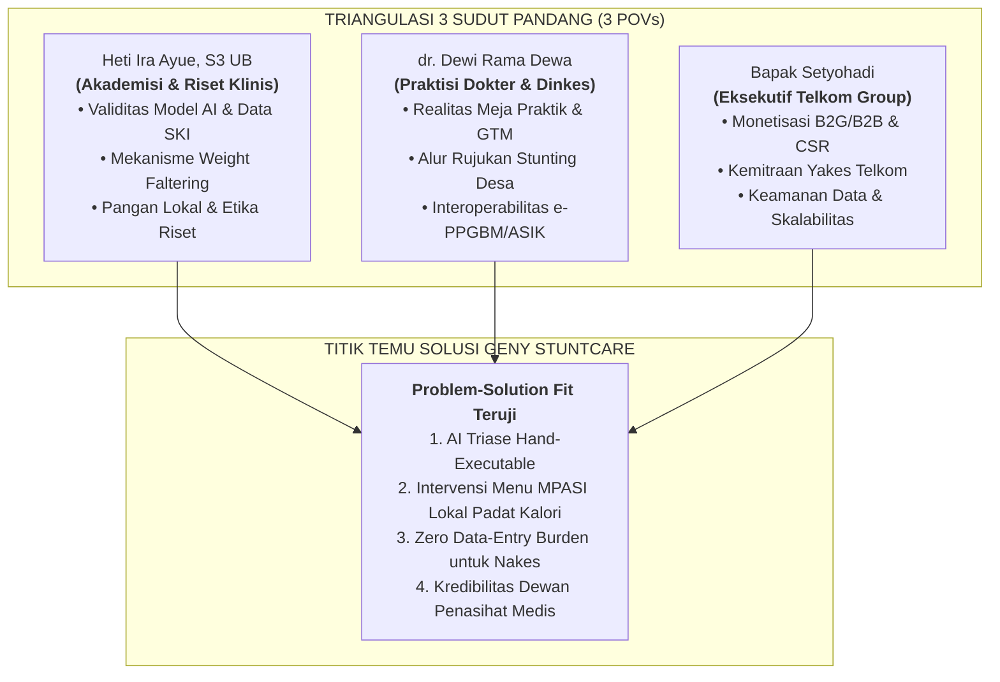
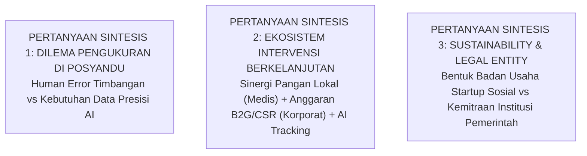

# 🎯 Panduan Strategis & Matriks Pertanyaan Rapat Dewan Pakar
## Konsultasi Tingkat Tinggi: Validasi Medis, Regulasi Pemerintah & Scale-Up Korporat
### Startup Geny StuntCare — Program Inkubasi Bisnis Startup Batch 24 Bandung Techno Park (Telkom University)

---

<p align="center">
  
  
  
  
  
</p>

---

## 📌 1. Metadata Pertemuan & Profil Mendalam Panel Pakar

Dokumen ini disusun sebagai instrumen panduan wawancara mendalam tingkat tinggi (*in-depth expert consultation guide*) untuk pertemuan strategis yang dijadwalkan pada **Selasa, 13 Oktober 2026**. Pertemuan ini menghadirkan tiga tokoh kunci lintas disiplin ilmu yang memiliki keahlian mendalam, pengalaman lapangan puluhan tahun, serta jejaring institusional yang luas:

| Profil Ahli / Pakar | Latar Belakang Pendidikan & Jabatan | Relevansi Kunci & Domain Kontribusi untuk Geny StuntCare |
| :--- | :--- | :--- |
| **Heti Ira Ayue, S.Kep., M.Kep., Sp.Kep.Anak** | • Dosen Jurusan Keperawatan, **Poltekkes Kemenkes Palangka Raya** (Kalimantan Tengah)<br>• **Lulusan / Kandidat Doktor (S3) Ilmu Kedokteran**, Fakultas Kedokteran **Universitas Brawijaya (UB) Malang**<br>• Pemohon Resmi Akses Data Mikro **Survei Kesehatan Indonesia (SKI) 2023** Kemenkes RI | • **Pakar Saintifik Epidemiologi & Keperawatan Anak**<br>• Validator metodologi analisis data mikro SKI 2023 yang menjadi fondasi *Paper GENY* (IBITeC 2026) dan *Buku Tugas Akhir* pemantauan stunting Kalteng.<br>• Rujukan ilmiah intervensi gagal tumbuh (*weight faltering*), gizi buruk, pola asuh, dan *Ethical Clearance* penelitian medis. |
| **dr. Dewi Rama Dewa** | • Praktisi Medis Aktif (**Dokter Praktik Mandiri / Fasilitas Pelayanan Kesehatan**)<br>• Pejabat / Fungsional Tenaga Medis di lingkungan **Dinas Kesehatan (Dinkes)** | • **Pakar Medis Klinis & Regulasi Kebijakan Kesehatan Daerah**<br>• Menguasai dinamika nyata ruang periksa dokter: psikologi ibu yang defensif, penanganan anak susah makan (GTM), dan peresepan suplemen.<br>• Memahami arsitektur birokrasi Dinkes: alur rujukan berjenjang penanganan stunting, alokasi dana BOK/DAK, serta beban kerja nakes terkait sistem Kemenkes (e-PPGBM/ASIK). |
| **Bapak Setyohadi** | • Profesional Sukses / Eksekutif Senior di lingkungan **Telkom Group**<br>• Berpengalaman luas dalam kepemimpinan korporasi teknologi, kemitraan strategis B2B/B2G, dan pengembangan ekosistem digital | • **Pakar Tata Kelola Korporasi, Scaling Bisnis & Jaringan Strategis**<br>• Membimbing model komersialisasi B2G (ke Pemda/Dinkes) dan B2B (ke korporat melalui CSR/TJSL penanganan stunting BUMN).<br>• Membuka jembatan sinergi dengan **Yayasan Kesehatan Telkom (Yakes)**, ekosistem **Bandung Techno Park**, serta kesiapan infrastruktur cloud terenkripsi (*compliance* UU PDP & ISO 27001). |

---

## 🧭 2. Arsitektur Triangulasi Strategis: 3 Sudut Pandang (3 POVs)

Pertemuan ini dirancang untuk membedah titik temu (*sweet spot*) antara **Kebenaran Saintifik Medis**, **Kelayakan Operasional Birokrasi Pemerintah**, dan **Viabilitas Bisnis Korporasi Teknologi**:



### Konteks Khusus Masukan Mentor Wulan Fitriani (Mentoring BTP Sesi 1, 8 Okt 2026):
Pertemuan ini adalah wahana utama untuk menindaklanjuti dan memvalidasi arahan kritis dari Mentor BTP Wulan Fitriani:
1. **Penajaman Segmen:** Mengonfirmasi apakah membatasi target pada **Ibu balita faltering/underweight usia 6–24 bulan** adalah keputusan klinis dan bisnis yang paling tepat.
2. **Diferensiasi Solusi:** Menguji apakah formula **AI Prediksi + Data Pertumbuhan + Personalized Action Plan MPASI Lokal** mampu memecahkan celah pasar yang ditinggalkan PrimaKu, Tentang Anak, dan Teman Bumil.
3. **Kredibilitas Medis:** Mengajak Heti Ira Ayue dan dr. Dewi Rama Dewa untuk berkenan menjadi **Dewan Penasihat Medis (*Medical Advisory Board*)** independen Geny StuntCare.
4. **Anti-Feature Creep:** Menolak fitur-fitur yang tidak berdampak langsung terhadap pemulihan berat badan balita.

---

## 🔬 3. Panduan Pertanyaan untuk Heti Ira Ayue (POV Akademisi & Riset Klinis)

> **Fokus Utama:** Validitas saintifik model machine learning, mekanisme biologis gagal tumbuh (*growth faltering*), densitas nutrisi MPASI lokal, metodologi instrumen wawancara, dan kepatuhan etika riset kesehatan.

```
┌─────────────────────────────────────────────────────────────────────────────────────────────┐
│ KLASTER A: VALIDASI MODEL MACHINE LEARNING & METODOLOGI DATA SKI 2023                       │
└─────────────────────────────────────────────────────────────────────────────────────────────┘
```

#### Pertanyaan A.1: Interpretasi Klinis Bobot Fitur pada Model Decision Tree (Paper GENY)
* **Redaksi Pertanyaan:**  
  *"Ibu Heti, pada Paper GENY yang kami susun berbasis data mikro SKI 2023 (304.193 balita), model Decision Tree CART kami menunjukkan bahwa tinggi/panjang badan dan usia mendominasi 98,23% feature importance, sementara variabel non-antropometri (sanitasi, ASI eksklusif, edukasi ibu, BBLR) memiliki bobot sangat kecil di pohon biner. Dari sudut pandang ilmu kedokteran dan epidemiologi anak, bagaimana Ibu memandang fenomena ini? Apakah model prediktif berbasis antropometri murni ini sudah cukup kuat untuk skrining awal di posyandu, ataukah variabel determinan lingkungan tetap wajib diintegrasikan sebagai penentu skor risiko sekunder?"*
* **Konteks & Rasionalitas:** Paper GENY mencatat macro F1 anjlok ke 0,3565 jika tinggi badan dan usia dihilangkan. Tim butuh konfirmasi ahli epidemiologi agar publikasi dan model AI tidak dituduh melakukan simplifikasi berlebihan.
* **Target Insight:** Batasan klaim algoritma (*algorithmic boundary*), rekomendasi integrasi variabel determinan sosial-ekonomi ke dalam skor risiko triase.
* **Probing:** *"Jika seorang kader melihat anak dengan tinggi badan berada di ambang batas z-score -1.9 SD (hampir stunting), variabel lingkungan apa dari data SKI yang paling mendesak dijadikan pertimbangan intervensi darurat?"*

#### Pertanyaan A.2: Validitas Konsep Trayektori Ganda (Buku TA Fuzzy Kalteng)
* **Redaksi Pertanyaan:**  
  *"Dalam penelitian Buku Tugas Akhir kami mengenai stunting di Kalimantan Tengah, kami menemukan kelemahan diagnosis konvensional posyandu yang bersifat statis (hanya melihat titik z-score saat diukur). Kami merancang Fuzzy Inference System Sugeno yang mengevaluasi trayektori ganda: membandingkan panjang badan lahir (PBL) dengan pertumbuhan saat pengukuran untuk mendeteksi 'catch-up growth' vs 'growth faltering'. Menurut Ibu, apakah pendekatan trayektori dinamis ini selaras dengan konsep klinis pemantauan anak di faskes, dan bagaimana cara terbaik menerapkannya dalam antarmuka aplikasi sederhana bagi ibu balita?"*
* **Konteks & Rasionalitas:** Buku TA Gerrard Sebastian membuktikan anak lahir normal bisa mengalami *faltering*, dan anak BBLR bisa mengejar pertumbuhan jika intervensi tepat.
* **Target Insight:** Validasi ilmiah model dinamis dan panduan klasifikasi klinis balita untuk algoritma Geny StuntCare.
* **Probing:** *"Di Kalimantan Tengah dengan karakteristik geografis perairan/pedalaman, seberapa sering Ibu menemui kasus anak yang lahir normal namun jatuh stunting setelah usia 6 bulan saat mulai MPASI?"*

```
┌─────────────────────────────────────────────────────────────────────────────────────────────┐
│ KLASTER B: VALIDASI KLINIS FENOMENA WEIGHT FALTERING & USIA MPASI (6–24 BULAN)              │
└─────────────────────────────────────────────────────────────────────────────────────────────┘
```

#### Pertanyaan B.3: Urgensi Periode Emas 6–24 Bulan sebagai Fokus Tunggal Startup
* **Redaksi Pertanyaan:**  
  *"Mentor inkubasi kami dari Bandung Techno Park (Ibu Wulan Fitriani) memberikan arahan tajam agar kami berhenti menyasar calon pengantin (catin) dan ibu hamil umum, melainkan fokus 100% pada satu persona: Ibu dengan balita usia 6–24 bulan yang mengalami weight faltering (berat badan seret) atau berada di garis kuning KMS. Dari kacamata keperawatan anak dan riset disertasi S3 Ibu, apakah pembatasan segmen ini merupakan titik intervensi biologis yang paling tepat dan paling krusial untuk mencegah stunting permanen?"*
* **Konteks & Rasionalitas:** Menjustifikasi keputusan pivot penajaman segmen dengan literatur kedokteran terkini.
* **Target Insight:** Konfirmasi patofisiologi bahwa *growth faltering* pada usia 6–24 bulan adalah gerbang utama stunting yang masih bersifat reversibel (dapat dipulihkan).
* **Probing:** *"Berapa lama rata-rata jendela waktu toleransi pemulihan berat badan (catch-up) sebelum kegagalan kenaikan BB anak berdampak permanen pada perlambatan panjang badan (linier growth arrest) dan retardasi kognitif?"*

#### Pertanyaan B.4: Fenomena Gerakan Tutup Mulut (GTM) dan Masalah Perilaku Makan
* **Redaksi Pertanyaan:**  
  *"Berdasarkan pengalaman klinis dan pengamatan lapangan Ibu pada ibu-ibu balita, apa faktor pemicu utama anak mengalami GTM berkepanjangan pada usia 6–12 bulan? Apakah mayoritas murni karena kesalahan tekstur/rasa menu MPASI, kurangnya protein hewani, atau akibat infeksi subklinis (seperti ISPA berulang, anemia defisiensi besi, atau infeksi saluran kemih)?"*
* **Konteks & Rasionalitas:** Menentukan apakah fitur Geny StuntCare cukup berfokus pada panduan resep menu atau harus menyertakan skrining gejala infeksi penyerta.
* **Target Insight:** Pemetaan akar masalah GTM untuk dimasukkan ke dalam algoritma triase cerdas.
* **Probing:** *"Bagaimana aplikasi digital dapat membedakan anak yang mogok makan karena 'fase perkembangan perilaku' biasa dengan anak yang mengalami anoreksia akibat penyakit kronis?"*

```
┌─────────────────────────────────────────────────────────────────────────────────────────────┐
│ KLASTER C: FORMULASI INTERVENSI NUTRISI MPASI BERBASIS PANGAN LOKAL                         │
└─────────────────────────────────────────────────────────────────────────────────────────────┘
```

#### Pertanyaan C.5: Standar Densitas Energi & Protein Hewani Pangan Lokal
* **Redaksi Pertanyaan:**  
  *"Salah satu nilai pembeda utama Geny StuntCare yang kami kembangkan adalah 'Personalized Action Plan MPASI Padat Kalori'. Kami ingin menghindari menu yang mahal atau sulit diakses warga. Berdasarkan riset nutrisi anak di Indonesia (khususnya komparasi wilayah Kalteng dan Jawa Timur), bahan pangan lokal hewani apa saja yang terbukti memiliki densitas protein dan asam amino esensial tertinggi, paling mudah diserap tubuh anak, namun harganya sangat terjangkau bagi keluarga miskin/menengah bawah?"*
* **Konteks & Rasionalitas:** Mengisi basis data resep pada platform `genystuntcare.com` agar berbasis bukti saintifik nutrisi anak (*evidence-based pediatric nutrition*).
* **Target Insight:** Daftar komoditas unggulan pangan lokal (misal: ikan gabus/haruan, lele, telur ayam ras, hati ayam) beserta rasio makronutrien ideal untuk balita *faltering*.
* **Probing:** *"Bagaimana takaran penambahan lemak tambahan (seperti minyak kelapa, santan, atau minyak ayam) yang aman untuk mendongkrak kalori balita faltering tanpa memicu diare?"*

```
┌─────────────────────────────────────────────────────────────────────────────────────────────┐
│ KLASTER D: AUDIT INSTRUMEN WAWANCARA (76 PERTANYAAN) & ETHICAL CLEARANCE                   │
└─────────────────────────────────────────────────────────────────────────────────────────────┘
```

#### Pertanyaan D.6: Telaah Beban Psikologis & Bias Bahasa pada Kuesioner Wawancara
* **Redaksi Pertanyaan:**  
  *"Kami telah menyusun instrumen 76 pertanyaan wawancara lapangan (folder wawancara) untuk menggali kebutuhan ibu balita. Kami menerapkan prinsip larangan menyebut kata 'stunting' di awal wawancara untuk mencegah rasa malu/stigma. Dari sudut pandang etika penelitian keperawatan, bagaimana telaah Ibu terhadap sensitivitas pertanyaan seputar kepatuhan makan dan kondisi ekonomi? Adakah pertanyaan yang berpotensi memicu rasa bersalah (mom guilt) dan bagaimana kami harus memitigasinya?"*
* **Konteks & Rasionalitas:** Memastikan kepatuhan etika penelitian dan melindungi kesejahteraan psikologis responden ibu balita.
* **Target Insight:** Rekomendasi perbaikan redaksional kuesioner dan protokol empati saat wawancara mendalam.
* **Probing:** *"Apa tanda-tanda non-verbal di lapangan yang menunjukkan bahwa ibu merasa dihakimi, dan bagaimana teknik probing yang elegan untuk mengembalikan rasa percaya responden?"*

#### Pertanyaan D.7: Alur Pengajuan Kelaikan Etik (Ethical Clearance)
* **Redaksi Pertanyaan:**  
  *"Untuk keperluan validasi klinis platform dan publikasi ilmiah di jurnal internasional bereputasi, riset kami mensyaratkan persetujuan etik (Ethical Clearance). Bagaimana prosedur dan syarat pengajuan kelaikan etik melalui Komisi Etik Penelitian Kesehatan (KEPK) di institusi Ibu (Poltekkes Kemenkes) atau FK UB untuk pengujian intervensi aplikasi mHealth seperti Geny StuntCare?"*
* **Konteks & Rasionalitas:** Mempersiapkan landasan hukum dan saintifik sebelum aplikasi diuji coba secara luas pada kelompok rentan.
* **Target Insight:** Estimasi waktu pengurusan, biaya, dokumen proposal, serta lembar persetujuan (*Informed Consent*) yang disyaratkan KEPK.

```
┌─────────────────────────────────────────────────────────────────────────────────────────────┐
│ KLASTER E: KESEDIAAN MENJADI ADVISOR & RENCANA RISET KOLABORATIF                           │
└─────────────────────────────────────────────────────────────────────────────────────────────┘
```

#### Pertanyaan E.8: Permohonan Kesediaan Menjadi Dewan Penasihat Medis (Medical Advisor)
* **Redaksi Pertanyaan:**  
  *"Ibu Heti, sebagai bagian dari inkubasi Bandung Techno Park dan pengembangan platform ini menuju implementasi riil, kami sangat membutuhkan bimbingan pakar yang memiliki integritas ilmiah tinggi seperti Ibu. Apakah Ibu berkenan untuk bergabung sebagai Medical & Research Advisor resmi Geny StuntCare guna mengawal validitas model komputasi dan panduan nutrisi kami? Serta apakah terbuka peluang riset kolaboratif antara tim kami di Telkom University dengan Poltekkes Kemenkes Kalteng?"*
* **Target Output:** Komitmen lisan/tertulis sebagai Scientific Advisor, membuka peluang *joint research* dan pengujian lapangan di Kalimantan Tengah.

---

## 🩺 4. Panduan Pertanyaan untuk dr. Dewi Rama Dewa (POV Praktisi Klinis & Dinkes)

> **Fokus Utama:** Realitas psikologis pasien di meja praktik, deteksi GTM, alur birokrasi rujukan stunting (Puskesmas ➔ RSUD), interoperabilitas sistem kesehatan pemerintah (e-PPGBM/ASIK), dan strategi pitching kemitraan B2G Dinas Kesehatan.

```
┌─────────────────────────────────────────────────────────────────────────────────────────────┐
│ KLASTER A: REALITAS RUANG PERIKSA DOKTER & PERILAKU IBU BALITA                              │
└─────────────────────────────────────────────────────────────────────────────────────────────┘
```

#### Pertanyaan A.1: Hambatan Komunikasi Klinis & Resistensi Ibu Terhadap Stunting
* **Redaksi Pertanyaan:**  
  *"Dokter Dewi, dalam pengalaman praktik sehari-hari berhadapan dengan orang tua, seberapa sering Ibu balita datang dengan kesadaran bahwa anaknya mengalami gagal tumbuh atau kurva KMS-nya mendatar? Mengapa di lapangan sangat sulit menemukan ibu yang secara jujur mengakui anaknya berisiko stunting? Bagaimana cara Dokter mengomunikasikan diagnosis faltering atau risiko stunting tanpa membuat ibu merasa tersinggung, takut, atau menutup diri?"*
* **Konteks & Rasionalitas:** Mengatasi masalah validasi yang diidentifikasi Mentor Wulan Fitriani: ibu sulit ditemukan karena merasa anaknya tidak bermasalah.
* **Target Insight:** Pola bahasa komunikasi medis (*clinical phrasing*) yang ramah pengguna untuk diadopsi pada notifikasi antarmuka Geny StuntCare.
* **Probing:** *"Kata atau frasa apa yang terbukti paling bisa diterima oleh ibu saat diberitahu bahwa berat badan anaknya perlu dikejar, tanpa menggunakan istilah medis yang menakutkan?"*

#### Pertanyaan A.2: Pola Perilaku Orang Tua Menghadapi GTM & Maraknya Suplemen Ilegal
* **Redaksi Pertanyaan:**  
  *"Ketika balita mengalami GTM kronis dan berat badannya seret, apa yang biasanya dilakukan ibu sebelum akhirnya memutuskan datang ke dokter? Seberapa sering Dokter menemui ibu yang membeli vitamin penambah nafsu makan, madu penggemuk anak, atau jamu secara mandiri lewat media sosial tanpa resep? Apa bahaya medis dari perilaku ini, dan bagaimana aplikasi kami dapat mengedukasi ibu agar kembali ke intervensi makanan bergizi?"*
* **Konteks & Rasionalitas:** Menguji pain point finansial orang tua yang membuang uang untuk suplemen tidak efektif.
* **Target Insight:** Validasi bahwa suplemen bebas adalah *wrong alternative solution* yang sedang digunakan pasar, membuka celah nilai (*value proposition*) bagi Geny StuntCare.
* **Probing:** *"Kapan sebuah suplemen seperti zat besi (Iron) atau Zinc mutlak diperlukan secara medis, dan kapan anak cukup diintervensi dengan modifikasi menu MPASI?"*

```
┌─────────────────────────────────────────────────────────────────────────────────────────────┐
│ KLASTER B: ALUR RUJUKAN RESMI STUNTING & TITIK SUMBATAN DI LAPANGAN (BOTTLENECK)           │
└─────────────────────────────────────────────────────────────────────────────────────────────┘
```

#### Pertanyaan B.3: Rekonstruksi Standar Operasional Alur Rujukan Stunting
* **Redaksi Pertanyaan:**  
  *"Dari sudut pandang Dinas Kesehatan, bagaimana Standar Operasional Prosedur (SOP) alur resmi penanganan balita stunting di desa dari hulu ke hilir? Mulai dari penemuan di Posyandu ➔ penanganan Bidan Desa ➔ evaluasi Dokter di Puskesmas ➔ Pemberian Makanan Tambahan Pemulihan (PMT Lokal / PKMK / F100) ➔ hingga rujukan ke Dokter Spesialis Anak (Sp.A) di RSUD? Di mana titik sumbatan (bottleneck) terbesar yang sering menyebabkan anak terlambat ditangani hingga usianya lewat 2 tahun?"*
* **Konteks & Rasionalitas:** Memastikan fitur Geny StuntCare mendukung alur rujukan resmi Kemenkes dan tidak membuat "sistem tandingan" yang membingungkan kader.
* **Target Insight:** Peta alur rujukan riil beserta titik-titik kegagalan eskalasi (misal: rujukan BPJS macet, kuota PKMK Puskesmas habis, ibu menolak dirujuk ke RS).
* **Probing:** *"Mengapa program Pemberian Makanan Tambahan (PMT) lokal sering dilaporkan kurang efektif di lapangan? Apakah karena menu tidak disukai anak, tidak dimakan anak melainkan dimakan keluarga lain, atau masalah ketepatan sasaran?"*

```
┌─────────────────────────────────────────────────────────────────────────────────────────────┐
│ KLASTER C: SISTEM DIGITAL KEMENKES (e-PPGBM/ASIK) & ZERO-BURDEN DESIGN UNTUK NAKES          │
└─────────────────────────────────────────────────────────────────────────────────────────────┘
```

#### Pertanyaan C.4: Mengapa Tenaga Kesehatan Menolak Aplikasi Tambahan?
* **Redaksi Pertanyaan:**  
  *"Mentor kami mencatat bahwa tenaga kesehatan (nakes) dan kader posyandu di lapangan sering menolak keras kehadiran aplikasi baru karena sudah sangat kelelahan dengan sistem wajib pemerintah (seperti e-PPGBM, ASIK, SatuSehat, dan Simpus). Bagaimana kondisi riil beban entri data kader dan bidan saat ini di dinas kesehatan? Menurut Dokter, bagaimana posisi terbaik Geny StuntCare agar tidak menjadi beban kerja baru, melainkan menjadi alat bantu yang meringankan pekerjaan mereka?"*
* **Konteks & Rasionalitas:** Menyelesaikan dilema desain pengguna: Geny StuntCare dirancang untuk keluarga, bukan menambah beban nakes.
* **Target Insight:** Konfirmasi batasan integrasi sistem. Nakes hanya sebagai penerima laporan ringkas atau validator rujukan, bukan operator input data harian.
* **Probing:** *"Jika aplikasi kami menyediakan fitur ekspor rekapitulasi data balita berisiko dalam format standar Excel/CSV yang sesuai dengan kolom e-PPGBM, apakah itu akan disambut positif oleh kader dan puskesmas?"*

#### Pertanyaan C.5: Kepatuhan Standar SatuSehat & Rekam Medis Elektronik (RME)
* **Redaksi Pertanyaan:**  
  *"Seiring dengan mandat transformasi digital Kemenkes melalui platform SatuSehat, apa standar regulasi dan interoperabilitas yang harus dipersiapkan startup kesehatan swasta agar suatu saat datanya dapat disinkronkan dengan rekam medis puskesmas atau klinik pratama? Apa batasan data yang boleh diakses dan wajib dijaga kerahasiaannya?"*
* **Target Insight:** Gambaran teknis integrasi HL7 FHIR SatuSehat Kemenkes dan aturan perlindungan kerahasiaan rekam medis balita.

```
┌─────────────────────────────────────────────────────────────────────────────────────────────┐
│ KLASTER D: STRATEGI PITCHING & KEMITRAAN B2G DINAS KESEHATAN                               │
└─────────────────────────────────────────────────────────────────────────────────────────────┘
```

#### Pertanyaan D.6: Masalah Terbesar Kepala Dinas Kesehatan Terkait Stunting
* **Redaksi Pertanyaan:**  
  *"Jika tim kami ingin beraudiensi dengan pimpinan Dinas Kesehatan (misal di Jawa Timur atau Kalimantan Tengah), cara pendekatan apa yang paling elegan? Masalah apa yang saat ini paling membuat Kepala Dinas Kesehatan pusing terkait indikator stunting (apakah angka prevalensi yang tidak kunjung turun, data D/S penimbangan yang rendah, atau anggaran penanganan stunting yang sulit dipertanggungjawabkan efektivitasnya)?"*
* **Konteks & Rasionalitas:** Menerapkan nasihat mentor: datang ke Dinkes dengan mendengarkan masalah mereka, bukan langsung menjual software.
* **Target Insight:** Rumusan *pain point* birokrasi pemerintah daerah yang dapat diselesaikan oleh analitik Geny StuntCare.
* **Probing:** *"Metrik apa yang paling dicari oleh Dinkes untuk membuktikan ke pimpinan daerah (Bupati/Walikota) bahwa intervensi stunting mereka berhasil?"*

#### Pertanyaan D.7: Jalur Anggaran Legal untuk Pilot Project di Faskes Daerah
* **Redaksi Pertanyaan:**  
  *"Pos anggaran apa di tingkat pemerintah daerah atau puskesmas yang secara regulasi legal dan memungkinkan untuk mendanai uji coba (pilot project) atau adopsi teknologi kesehatan digital pencegahan stunting? Apakah memungkinkan melalui Bantuan Operasional Kesehatan (BOK) Puskesmas, Dana Bagi Hasil Cukai Tembakau (DBHCT), atau pos DAK Non-Fisik?"*
* **Target Insight:** Pemetaan skema penganggaran pemerintah untuk kelayakan model bisnis B2G Geny StuntCare di Stage 2 Inkubasi.

---

## 💼 5. Panduan Pertanyaan untuk Bapak Setyohadi (POV Eksekutif Telkom Group & Scaling)

> **Fokus Utama:** Kemitraan strategis Telkom Group (Yakes, TJSL/CSR), model bisnis B2B/B2G yang *sustainable*, arsitektur cloud terenkripsi & kepatuhan UU PDP, milestone kelulusan inkubasi BTP, dan pemanfaatan jejaring korporat.

```
┌─────────────────────────────────────────────────────────────────────────────────────────────┐
│ KLASTER A: SINERGI EKOSISTEM TELKOM GROUP & YAYASAN KESEHATAN TELKOM (YAKES)                │
└─────────────────────────────────────────────────────────────────────────────────────────────┘
```

#### Pertanyaan A.1: Pintu Masuk Kemitraan dengan Yakes Telkom
* **Redaksi Pertanyaan:**  
  *"Pak Setyohadi, dalam dokumen action plan validasi masalah kami, kami menargetkan Yayasan Kesehatan Telkom (Yakes) sebagai mitra validasi ahli dan potensial partner faskes. Berdasarkan pengalaman Bapak di Telkom Group, bagaimana tata kelola dan pintu masuk yang paling tepat untuk menjajaki pilot project pemantauan tumbuh kembang anak karyawan Telkom di klinik-klinik Yakes? Siapa divisi pengambil keputusan yang harus kami temui terlebih dahulu?"*
* **Konteks & Rasionalitas:** Mengubah rencana uji ahli Yakes di dokumen SLR-1 menjadi aksi nyata berbiaya rendah dan berdaya ungkit tinggi.
* **Target Insight:** Jalur birokrasi internal Telkom, pengenalan ke pengambil keputusan Yakes Telkom atau Divisi Human Capital Telkom.
* **Probing:** *"Apakah di Telkom Group saat ini terdapat inisiatif 'Wellbeing & Family Healthcare' untuk karyawan muda yang memiliki balita yang dapat disinergikan dengan platform kami?"*

#### Pertanyaan A.2: Skema Pendanaan TJSL/CSR BUMN Penanganan Stunting
* **Redaksi Pertanyaan:**  
  *"BUMN saat ini memiliki program prioritas Tanggung Jawab Sosial dan Lingkungan (TJSL) untuk percepatan penurunan stunting nasional. Bagaimana mekanisme startup binaan kampus Telkom University dapat berkolaborasi dengan program CSR Telkom Group atau Satgas Stunting BUMN? Format proposal seperti apa yang dinilai akuntabel dan menarik bagi pengelola dana TJSL Telkom?"*
* **Konteks & Rasionalitas:** Solusi atas rendahnya daya beli B2C keluarga miskin stunting: korporat bertindak sebagai *payer* (pembayar) melalui dana CSR, sementara warga menjadi *user*.
* **Target Insight:** Peluang pengajuan dana hibah implementasi/pilot project desa binaan Telkom (misal desa binaan di Jawa Timur atau Jawa Barat).

```
┌─────────────────────────────────────────────────────────────────────────────────────────────┐
│ KLASTER B: VALIDASI MODEL BISNIS ENTERPRISE & SKALABILITAS FINANSIAL                        │
└─────────────────────────────────────────────────────────────────────────────────────────────┘
```

#### Pertanyaan B.3: Model Bisnis B2G vs B2B untuk Pasar Kesehatan Piramida Bawah
* **Redaksi Pertanyaan:**  
  *"Hasil riset crawling dan lapangan kami menunjukkan fenomena 'Tahu Tapi Tidak Mampu': keluarga yang berisiko tinggi stunting justru berada di kuintil ekonomi terbawah yang tidak sanggup membayar biaya langganan aplikasi bulanan (B2C paywall). Dari kacamata enterprise sales Telkom, model bisnis apa yang paling tangguh untuk platform semacam ini? Apakah model B2G lisensi per desa/puskesmas, atau B2B ke perusahaan perkebunan/tambang yang wajib mengurus kesehatan warga sekitar konsesi?"*
* **Konteks & Rasionalitas:** Mencegah kegagalan model monetisasi sebelum masuk ke tahap pembuatan MVP final (SRL-3 & SRL-5).
* **Target Insight:** Rekomendasi struktur penetapan harga (*pricing model*), kontrak tahunan B2G vs B2B, dan unit economics yang realistis.
* **Probing:** *"Berapa kisaran harga per lisensi puskesmas atau per desa yang dinilai wajar dan tidak memberatkan pos anggaran daerah?"*

```
┌─────────────────────────────────────────────────────────────────────────────────────────────┐
│ KLASTER C: ARSITEKTUR CLOUD, KEAMANAN DATA SENSITIF & KEPATUHAN UU PDP                      │
└─────────────────────────────────────────────────────────────────────────────────────────────┘
```

#### Pertanyaan C.4: Kepatuhan UU Pelindungan Data Pribadi (UU PDP) & Data Anak
* **Redaksi Pertanyaan:**  
  *"Platform Geny StuntCare menyimpan data sensitif: rekam pertumbuhan antropometri balita, foto kondisi anak, dan profil ekonomi keluarga. Mengingat UU Pelindungan Data Pribadi (UU PDP) nomor 27 tahun 2022 memberikan perlindungan sangat ketat terhadap data anak dan data kesehatan spesifik, standar arsitektur cloud, enkripsi, dan data sovereignty seperti apa yang wajib kami siapkan? Apakah startup seperti kami dapat memanfaatkan fasilitas cloud/data center Telkom (seperti NeuCentrIX) dengan skema inkubasi?"*
* **Konteks & Rasionalitas:** Memastikan kepatuhan hukum penuh terhadap keamanan data medis sebelum meluncurkan versi produksi komersial.
* **Target Insight:** Kebutuhan sertifikasi (ISO 27001), enkripsi database (AES-256), serta program dukungan kredit cloud bagi startup binaan Telkom.
* **Probing:** *"Dokumen kebijakan privasi dan persetujuan orang tua (parental consent) seperti apa yang wajib ada di aplikasi agar terhindar dari sanksi hukum di masa depan?"*

```
┌─────────────────────────────────────────────────────────────────────────────────────────────┐
│ KLASTER D: NAVIGASI PROGRAM INKUBASI BTP & TAHAPAN VENTURE ACCELERATION                    │
└─────────────────────────────────────────────────────────────────────────────────────────────┘
```

#### Pertanyaan D.5: Ekspektasi Komite Reviewer BTP & Standar Kelulusan Stage 1
* **Redaksi Pertanyaan:**  
  *"Sebagai startup binaan Bandung Techno Park yang sedang menyelesaikan Stage 1 (Problem Validation), menurut pandangan Bapak, apa bukti paling kuat yang harus ditunjukkan oleh tim founder untuk meyakinkan komite reviewer dan calon investor bahwa masalah yang kami angkat benar-benar tervalidasi? Apakah komitmen Letter of Intent (LoI) dari faskes, traksi awal ratusan pengguna aktif, atau pembuktian retensi penggunaan?"*
* **Konteks & Rasionalitas:** Memastikan tim fokus menghasilkan *deliverables* yang dinilai tinggi saat sesi *evaluation pitching* Stage 1 BTP.
* **Target Insight:** Kriteria penilaian komite juri Telkom/BTP dan tips mengamankan pendanaan lanjutan ke Stage 2 dan Stage 3.
* **Probing:** *"Kesalahan paling umum apa yang sering Bapak lihat pada startup berbasis riset mahasiswa/dosen saat mempresentasikan produk ke jajaran eksekutif korporat?"*

#### Pertanyaan D.6: Pemanfaatan Jaringan & Rekomendasi Ekosistem
* **Redaksi Pertanyaan:**  
  *"Pak Setyohadi, dengan jaringan luas yang Bapak miliki di lingkungan Telkom Group dan ekosistem bisnis digital, apakah Bapak bersedia menjadi Business & Strategic Advisor bagi Geny StuntCare? Serta adakah pihak di jajaran Telkom Regional (misal Jawa Timur) atau mitra CSR yang dapat Bapak hubungkan dengan kami untuk uji coba awal lapangan?"*
* **Target Output:** Komitmen sebagai Business Advisor, perkenalan ke jejaring Witel/Regional Telkom atau pengelola program CSR stunting.

---

## 🌟 6. Matriks Pertanyaan Sintesis Lintas Sektor (Cross-Domain Synthesis)

Pertanyaan-pertanyaan ini diajukan pada sesi diskusi terbuka (*open forum*) di mana ketiga pakar hadir bersama, guna memicu kolaborasi lintas keahlian:



1. **Sintesis Medis vs Komputasi (Heti Ira Ayue $\leftrightarrow$ dr. Dewi Rama Dewa):**  
   *"Timbangan posyandu di lapangan terkenal memiliki variasi tinggi (dacin vs timbangan digital klinik). Jika orang tua menimbang mandiri di rumah atau posyandu dengan deviasi $\pm 300\text{ gram}$, bagaimana model AI kami harus mentoleransi noise data ini agar tidak memicu alarm palsu (false alarm) yang membuat ibu panik atau dokter kewalahan menerima rujukan yang salah?"*
2. **Sintesis Medis vs Bisnis (Heti Ira Ayue $\leftrightarrow$ Bpk. Setyohadi):**  
   *"Ibu Heti meriset bahan pangan lokal unggulan padat kalori, sementara Pak Setyohadi memahami rantai pasok dan CSR korporat. Mungkinkah Geny StuntCare tidak hanya merekomendasikan resep di aplikasi, tetapi bermitra dengan UMKM pangan lokal atau BUMN Pangan untuk menyalurkan paket bahan mentah MPASI terstandar melalui pendanaan CSR?"*
3. **Sintesis Birokrasi vs Enterprise (dr. Dewi Rama Dewa $\leftrightarrow$ Bpk. Setyohadi):**  
   *"dr. Dewi memahami bagaimana anggaran stunting berputar di APBD/BOK, sementara Pak Setyohadi memahami kontrak pengadaan teknologi skala B2G. Bagaimana format penawaran kerja sama tripartit (Startup Telkom University + Dinas Kesehatan + Telkom Group) yang secara hukum paling aman dari audit BPK dan menguntungkan kedua belah pihak?"*

---

## ⏱️ 7. Protokol Eksekusi Rapat & Manajemen Waktu (Timeboxing)

Untuk memastikan rapat berjalan dinamis, profesional, dan seluruh poin penting terjawab dalam durasi **75–90 menit**, gunakan struktur pembagian waktu berikut:

| Sesi | Durasi | Alokasi Waktu | Aktivitas & Sasaran Utama | Penanggung Jawab |
| :---: | :---: | :---: | :--- | :--- |
| **I** | **5 Menit** | 00.00 – 00.05 | **Pembukaan & Salam Hormat:** Pengenalan singkat profil tim Geny StuntCare, apresiasi kehadiran para pakar, dan penegasan tujuan pertemuan (meminta arahan ahli, bukan berjualan). | Gerrard Sebastian |
| **II** | **7 Menit** | 00.05 – 00.12 | **Elevator Pitch Masalah (Anti-Pitching):** Memaparkan temuan Paper GENY, Buku TA Kalteng, masukan Mentor BTP Wulan Fitriani, dan fokus ke balita *faltering* 6–24 bulan. | Gerrard Sebastian |
| **III** | **25 Menit** | 00.12 – 00.37 | **Penyelaman Sesi 1: Heti Ira Ayue (Saintifik & Klinis):** Membedah Klaster A s.d. E (Model SKI, GTM, Pangan Lokal, KEPK). | Tim & Heti Ira Ayue |
| **IV** | **25 Menit** | 00.37 – 01.02 | **Penyelaman Sesi 2: dr. Dewi Rama Dewa (Praktik & Dinkes):** Membedah Klaster A s.d. D (Psikologi Pasien, Alur Rujukan, e-PPGBM, Pitching Dinkes). | Tim & dr. Dewi Rama Dewa |
| **V** | **20 Menit** | 01.02 – 01.22 | **Penyelaman Sesi 3: Bapak Setyohadi (Telkom & Enterprise):** Membedah Klaster A s.d. D (Yakes, CSR, Model Bisnis, UU PDP, Inkubasi BTP). | Tim & Bpk. Setyohadi |
| **VI** | **8 Menit** | 01.22 – 01.30 | **Diskusi Terbuka Sintesis & Permohonan Komitmen:** Mengajukan pertanyaan triangulasi, merangkum poin konsensus, dan meminta kesediaan resmi bergabung sebagai Dewan Penasihat (*Advisory Board*). | Seluruh Peserta |

### Aturan Emas Pertemuan (*Golden Rules of Engagement*):
1. **Prinsip 80/20:** Tim berbicara maksimal 20% waktu. Biarkan ketiga pakar mengekspresikan pandangan, kritik, dan pengalaman mereka sebanyak 80% waktu.
2. **Catat Verbatim & Rekam:** Seluruh kutipan emosional, istilah birokrasi, dan saran medis wajib dicatat secara harfiah (*verbatim*) atau direkam atas persetujuan para pakar.
3. **Dilarang Bersikap Defensif:** Jika ada aspek teknologi atau model bisnis yang dikritik tajam oleh pakar, jangan berdebat. Catat kritik tersebut sebagai risiko validasi (*validation risk*) yang berharga.

---

## 📋 8. Matriks Kebutuhan Proyek (*Project Needs Checklist*)

Gunakan lembar kendali berikut saat rapat berlangsung untuk memastikan tidak ada celah informasi yang terlewat:

| Komponen Kebutuhan Proyek | Target Temuan dari Pertemuan | Status Verifikasi | Ahli Terkait |
| :--- | :--- | :---: | :---: |
| **Validasi Model AI (Paper GENY)** | Kepastian apakah model pohon CART cukup andal tanpa data laboratorium | [ ] Terjawab | Heti Ira Ayue |
| **Definisi Klinis Weight Faltering** | Kriteria batas penurunan berat badan sebelum intervensi wajib dimulai | [ ] Terjawab | Heti Ira Ayue / dr. Dewi |
| **Formula Menu MPASI Lokal** | Daftar 3 komoditas protein hewani lokal termurah & paling padat nutrisi | [ ] Terjawab | Heti Ira Ayue |
| **Penanganan Psikologis Ibu GTM** | Kalimat komunikasi non-menghakimi untuk antarmuka aplikasi | [ ] Terjawab | dr. Dewi Rama Dewa |
| **Titik Hambatan Rujukan Puskesmas** | Alasan mengapa rujukan balita stunting sering gagal di lapangan | [ ] Terjawab | dr. Dewi Rama Dewa |
| **Format Laporan Ekspor Nakes** | Format tabel rekap yang disukai nakes agar aplikasi bersifat *zero-burden* | [ ] Terjawab | dr. Dewi Rama Dewa |
| **Pintu Masuk Pilot Project Yakes** | Nama divisi atau PIC di Yakes Telkom untuk pengajuan proposal uji coba | [ ] Terjawab | Bapak Setyohadi |
| **Model Penetapan Harga B2G/CSR** | Angka acuan biaya lisensi per desa/faskes yang realistis diserap anggaran | [ ] Terjawab | Bapak Setyohadi |
| **Kepatuhan Regulasi UU PDP** | Ketentuan enkripsi data anak dan lokasi server lokal (NeuCentrIX) | [ ] Terjawab | Bapak Setyohadi |
| **Komitmen Dewan Penasihat** | Kesediaan minimal 2 dari 3 pakar menjadi Advisor resmi Geny StuntCare | [ ] Terjawab | Semua Pakar |

---

<p align="center">
  <em>Disusun dengan standar metodologi riset ilmiah dan tata kelola startup inkubasi Bandung Techno Park (Telkom University).</em>
</p>
