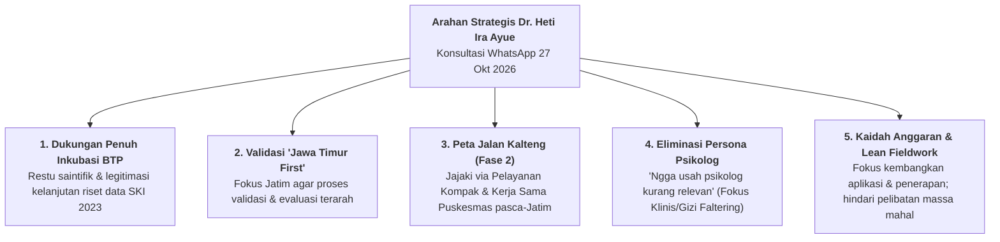
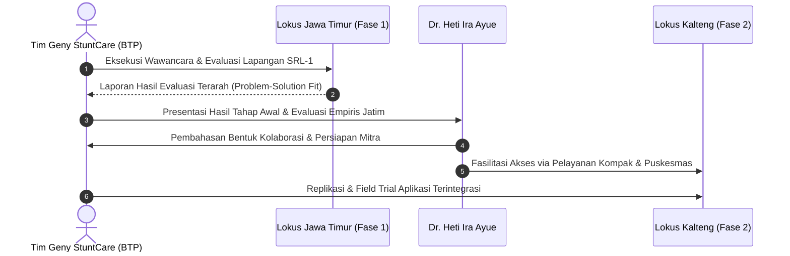

# 📱 NOTULENSI & RANGKUMAN KONSULTASI STRATEGIS ASINKRON DEWAN PAKAR
## Sesi Konsultasi Eksklusif: Prof. / Dr. Heti Ira Ayue, S.ST., M.Keb. via WhatsApp
### Validasi Strategis Inkubasi BTP, Metodologi "Jawa Timur First", Road-Map Kalteng, dan Tata Kelola Anggaran Lapangan
**Program Inkubasi Bisnis Startup Batch 24 — Bandung Techno Park (Telkom University)**

---

<p align="center">
  
  
  
  
  
  
</p>

---

## 📌 1. Metadata Konsultasi & Profil Narasumber

| Parameter | Keterangan Rinci |
| :--- | :--- |
| **Topik Konsultasi** | Validasi Metodologi Riset Lapangan (Jatim vs Kalteng), Arah Pengembangan Aplikasi, Skema Kemitraan Palangka Raya, Eliminasi Persona Psikolog, dan Manajemen Anggaran Operasional Lapangan |
| **Waktu Pelaksanaan** | Selasa, 27 Oktober 2026 (Pukul 14.28 – 19.36 WIB) |
| **Media Komunikasi** | Asinkron Resmi via WhatsApp Messenger |
| **Narasumber Ahli** | **Prof. / Dr. Heti Ira Ayue, S.ST., M.Keb.**<br/>• Dosen Senior Jurusan Kebidanan, Poltekkes Kemenkes Palangka Raya<br/>• Doktor (S3) Ilmu Kedokteran, Fakultas Kedokteran Universitas Brawijaya (UB) Malang<br/>• Pemohon Resmi Akses Data Mikro SKI 2023 Kemenkes RI (Surat FK UB No. 06361/2024)<br/>• Penulis Utama Paper Bereputasi Internasional: *"Exploring the multifactorial predictors of stunting in children under five"* (Journal of Public Health Research, 2024)<br/>• Pelopor Program Kelompok Pendukung ASI (KP-ASI) & Inovasi Gizi Ibu-Anak Kalteng |
| **Pewawancara / Notulis** | **Gerrard Sebastian** (Founder / Project Lead Geny StuntCare — Mahasiswa Telkom University Surabaya & Tenant Inkubasi BTP Batch 24) |
| **Konteks Situasional** | Dr. Heti sedang dalam persiapan intensif Akreditasi Institusi di Poltekkes Kemenkes Palangka Raya, sehingga konsultasi dilaksanakan secara asinkron dengan fokus pada arahan strategis, manajerial, dan validasi arah produk (*high-level tactical guidance*). |
| **Status Temuan** | *Primary Expert Advisory Intelligence* — Diverifikasi dari transkrip percakapan digital resmi. |

---

## 💬 2. Transkrip Asli Percakapan Digital (WhatsApp Chat Log)

Berikut adalah rekaman transkrip percakapan autentik tertanggal **27 Oktober 2026**:

```text
[14:28, 10/27/2026] gerrardgs: Selamat ge sudah lolos inkubasi BTP, Teti mendukung pengembangannya. Fokus dulu di Jawa Timur spy proses validasi dan evaluasinya lebih terarah.
Untuk Palangka Raya atau Kalteng, nanti bisa ja kita jajaki bersama, bisa lewat kegiatan pelayanan Kompak maupun kerja sama dengan puskesmas. Setelah hasil tahap awalnya ada, kita bisa bahas bentuk kolaborasi dan persiapan mitranya.
thankss tetiiii

okeyyy tetiiii
[14:29, 10/27/2026] gerrardgs: makasih lah tetii jawabann2 nyaa wkwkwkw
[14:29, 10/27/2026] gerrardgs: lgsg kuproses ni
[14:29, 10/27/2026] gerrardgs: btw teti adakah relasi yang bisa diajak kerjasama gitu tetii di jawa timur
[14:29, 10/27/2026] gerrardgs: ttg program ini
[14:29, 10/27/2026] Teti: Teti sibuk mau akre makanya sulit punya waktu mbaca yg ppanjang dan serius😄
[14:30, 10/27/2026] gerrardgs: List Pertanyaan:

dalam publikasi terbaru teti di Journal of Public Health Research (2024) yang mengulas 'Multifactorial predictors of stunting in children under five', disitu menegaskan bahwa stunting dipicu oleh interaksi kompleks gizi, sanitasi, infeksi, dan pengasuhan. Namun, pada Paper GENY kami berbasis data mikro SKI 2023 yang teti ajukan ke Kemenkes, model Decision Tree CART kami menemukan bahwa tinggi/panjang badan dan usia mendominasi 98,23% feature importance. Dari sudut pandang metodologi penelitian kedokteran, bagaimana kami harus menyandingkan temuan pohon biner ini dengan teori multifaktorial teti agar sistem triase kami tidak dianggap menyederhanakan determinan biologis anak?" 
Jika anak terdeteksi berada di ambang batas z-score -1.9 SD (ha
yang pertanyaan 11 tetii

Psikolog juga bolehh kalau teti ada sarann
[14:30, 10/27/2026] gerrardgs: Teti sibuk mau akre makanya sulit punya waktu mbaca yg ppanjang dan serius
nahh itudiaa wkwkwkwkw padat banar tu pasti🤣🤣
[14:31, 10/27/2026] Teti: btw teti adakah relasi yang bisa diajak kerjasama gitu tetii di jawa timur
Ngga usah psikolog kurang relevan
[14:32, 10/27/2026] Teti: Dapat dana brp projek itu? Siapa ketua timnya?
[14:40, 10/27/2026] gerrardgs: Ngga usah psikolog kurang relevan
okee tetiii
[14:41, 10/27/2026] gerrardgs: Dapat dana brp projek itu? Siapa ketua timnya?
ketua timnya ada mahasiswa informatika angkatan 24
[14:41, 10/27/2026] gerrardgs: dananya kemaren puluhan juta teti cuma udah habis pakai smua
[14:42, 10/27/2026] gerrardgs: ini dilomba skrg dapet jg tapi blm tau brp exact angkanya masi ditanyain nii
[14:57, 10/27/2026] Teti: Kamu ngajak org itu hrs ada rewardnya. Semakin byk melibatkan org makin byk dananya. Utk makan, transfort lokal dll
[14:58, 10/27/2026] Teti: Lbh baik mengembangkan aplikasi dan penerapan. Kalau melibatkan mitra dan masy2 uangnya byk
[16:31, 10/27/2026] gerrardgs: ini dilomba skrg dapet jg tapi blm tau brp exact angkanya masi ditanyain nii
500k tetii
[16:31, 10/27/2026] gerrardgs: Kamu ngajak org itu hrs ada rewardnya. Semakin byk melibatkan org makin byk dananya. Utk makan, transfort lokal dll
iyaa kemaren tu sampe conference lagi kan ini papernya
[16:32, 10/27/2026] gerrardgs: kalo menang lomba lebi banyak kok uangnya ni teti
[19:36, 10/27/2026] gerrardgs: Kamu ngajak org itu hrs ada rewardnya. Semakin byk melibatkan org makin byk dananya. Utk makan, transfort lokal dll
rencananya untuk sekarang untuk wawancara aja sih tetii
```

---

## 🌟 3. Ringkasan Eksekutif (5 Pilar Arahan Strategis Dr. Heti Ira Ayue)



1. **Restu Akademis & Dukungan Penuh Inkubasi BTP:** Dr. Heti secara resmi mengucapkan selamat dan menyatakan mendukung penuh partisipasi Geny StuntCare dalam Program Inkubasi Startup BTP Batch 24 Telkom University. Ini mengukuhkan hubungan historis antara periset data mikro SKI 2023 Kemenkes dengan implementasi hilirisasi teknologi.
2. **Validasi Mutlak Strategi Geografis ("Jawa Timur First"):** Dr. Heti menginstruksikan secara tegas: *"Fokus dulu di Jawa Timur spy proses validasi dan evaluasinya lebih terarah."* Konsensus ini sejalan 100% dengan masukan dr. Dewi Rama Dewa dan Mentor Wulan Fitriani BTP.
3. **Peta Jalan Konkret Replikasi ke Kalimantan Tengah (Fase 2):** Untuk ekspansi lokus ke Palangka Raya / Kalteng, Dr. Heti menyiapkan dua instrumen kemitraan nyata: (a) Kegiatan pelayanan masyarakat **Kompak** dan (b) Kerja sama langsung dengan **Puskesmas**. Skema kolaborasi dan mitra akan dipersiapkan bersama setelah hasil evaluasi empiris tahap awal di Jawa Timur terbit.
4. **Penajaman Ruang Lingkup: Eliminasi Persona Psikolog (*Anti-Scope Creep*):** Menanggapi pertanyaan tentang potensi kerja sama dengan psikolog di Jawa Timur, Dr. Heti secara lugas memutus wacana tersebut: *"Ngga usah psikolog kurang relevan."* Startup tahap awal harus berfokus pada akar patologis dan asupan gizi balita faltering, bukan melebar ke dimensi konseling psikologi umum.
5. **Kaidah Anggaran Operasional Lapangan (*Lean Operations vs Heavy Field Cost*):** Dr. Heti memberikan nasihat manajerial tajam mengenai realitas pelibatan manusia di lapangan: *"Kamu ngajak org itu hrs ada rewardnya. Semakin byk melibatkan org makin byk dananya. Utk makan, transfort lokal dll. Lbh baik mengembangkan aplikasi dan penerapan. Kalau melibatkan mitra dan masy2 uangnya byk."* Tim diarahkan untuk menjaga efisiensi kas (*burn rate*) dengan fokus pada penyempurnaan produk digital dan wawancara kualitatif ramping.

---

## 🔍 4. Pembedahan Mendalam Hasil Wawancara Per Topik

### A. Legitimasi Akademis & Kelanjutan Riset Data Mikro SKI 2023
* **Konteks Hubungan:** Dr. Heti Ira Ayue adalah pemohon resmi surat izin akses data mikro Survei Kesehatan Indonesia (SKI) 2023 dari Badan Kebijakan Pembangunan Kesehatan (BKPK) Kemenkes RI melalui Fakultas Kedokteran Universitas Brawijaya (Surat No. 06361/2024).
* **Signifikansi Pernyataan:** Pernyataan *"Teti mendukung pengembangannya"* memberikan kepastian hukum dan etika akademis bahwa algoritma machine learning CART Decision Tree (Paper IBITeC 2026) dan logika triase yang dibangun tim memiliki restu penuh dari pemilik hak akses primer data tersebut.
* **Tindak Lanjut:** Mempertahankan atribusi sitasi riset Dr. Heti dalam setiap publikasi ilmiah, proposal hibah, dan materi presentasi (*pitch deck*) BTP.

---

### B. Validasi Metodologi: Mengapa "Jawa Timur First" Adalah Keputusan Tepat?
* **Pernyataan Narasumber:** *"Fokus dulu di Jawa Timur spy proses validasi dan evaluasinya lebih terarah."*
* **Rasionalitas Saintifik & Metodologis:**
  1. *Pengendalian Variabel:* Jawa Timur memiliki kepadatan posyandu yang tinggi, konektivitas jalan darat antarkota/desa yang stabil, dan kepatuhan administrasi kader yang terstruktur. Hal ini meminimalkan bias variabel pengganggu (*confounding factors*) akibat kendala geografis pedalaman.
  2. *Evaluasi Terarah:* Membatasi wilayah pengujian pada 8 titik lokus Jawa Timur (Surabaya, Sidoarjo, Malang, Banyuwangi, Magetan, Jember) memungkinkan tim mencapai saturasi data kualitatif dengan cepat dan presisi.
  3. *Kesepakatan Seluruh Pakar:* 
     * **dr. Dewi Rama Dewa (14 Okt 2026):** Menyetujui validasi di Jatim karena kader posyandu memiliki operasional/transport jelas dan faskes mudah dijangkau darat.
     * **Mentor Wulan Fitriani (8 Okt 2026):** Meminta fokus validasi 100% pada satu segmen terukur.
     * **Dr. Heti Ira Ayue (27 Okt 2026):** Mengunci restu agar evaluasi diselesaikan di Jatim terlebih dahulu.

---

### C. Peta Jalan Replikasi ke Kalimantan Tengah: Pelayanan "Kompak" & Puskesmas
* **Pernyataan Narasumber:** *"Untuk Palangka Raya atau Kalteng, nanti bisa ja kita jajaki bersama, bisa lewat kegiatan pelayanan Kompak maupun kerja sama dengan puskesmas. Setelah hasil tahap awalnya ada, kita bisa bahas bentuk kolaborasi dan persiapan mitranya."*
* **Dua Pintu Masuk Kolaborasi Kalteng (Fase 2):**
  1. **Kegiatan Pelayanan "Kompak":** Wadah kegiatan pelayanan kesehatan sosial/kemasyarakatan berbasis komunitas yang dibina atau diikuti oleh Dr. Heti di Palangka Raya. Menjadi wahana uji coba (*community trial*) tanpa birokrasi pemerintahan yang kaku.
  2. **Kerja Sama dengan Puskesmas:** Kolaborasi faskes primer resmi melalui jaringan Poltekkes Kemenkes Palangka Raya dan Dinas Kesehatan Kota Palangka Raya (bersinergi dengan rekomendasi dr. Dewi Rama Dewa untuk Puskesmas Menteng dan Bukit Hindu).
* **Syarat Tindak Lanjut (*Prerequisite*):** Dr. Heti menetapkan syarat jelas: **tuntaskan hasil tahap awal (evaluasi data Jatim)** terlebih dahulu, barulah tim duduk bersama untuk membahas formulasi kemitraan dan persiapan teknis mitra di Kalteng.



---

### D. Penajaman Ruang Lingkup: Eliminasi Persona Psikolog (*Anti-Scope Creep*)
* **Pertanyaan Pewawancara:** *"btw teti adakah relasi yang bisa diajak kerjasama gitu tetii di jawa timur ttg program ini... Psikolog juga bolehh kalau teti ada sarann"*
* **Jawaban Tegas Dr. Heti:** *"Ngga usah psikolog kurang relevan."*
* **Analisis & Keputusan Produk:**
  * Pada diskusi sebelumnya bersama dr. Dewi Rama Dewa (14 Okt 2026), sempat muncul bahasan dimensi kejiwaan ibu hamil KEK/nikah dini dan wacana melibatkan mahasiswa psikologi.
  * Namun, Dr. Heti memandang dari kacamata kepakaran gizi klinis anak dan efektivitas intervensi startup: **masalah utama balita faltering usia 6–24 bulan adalah defisit asupan energi-protein, tekstur MPASI, serta infeksi subklinis.**
  * Menghadirkan fitur atau persona psikolog pada aplikasi saat ini hanya akan menciptakan *scope creep*, mengaburkan *Value Proposition Canvas* (VPC), membingungkan pengguna, dan menghamburkan anggaran riset.
  * **Keputusan Final:** Persona dan modul psikolog **RESMI DIHILANGKAN** dari lingkup kerja Stage 1 BTP. Fokus diarahkan 100% pada **Ibu Balita Faltering 6–24 Bulan, Nakes Puskesmas, dan Kader Posyandu**.

---

### E. Hukum Besi Operasional Lapangan: Kaidah Reward, Transport, & Alokasi Anggaran
* **Pertanyaan Dr. Heti:** *"Dapat dana brp projek itu? Siapa ketua timnya?"*
* **Nasihat Emas Dr. Heti:**
  > *"Kamu ngajak org itu hrs ada rewardnya. Semakin byk melibatkan org makin byk dananya. Utk makan, transfort lokal dll. Lbh baik mengembangkan aplikasi dan penerapan. Kalau melibatkan mitra dan masy2 uangnya byk."*
* **Bedah Prinsip Manajemen Biaya (*Financial Discipline*):**
  1. *The Real Cost of Field Engagement:* Mengajak mitra lapangan (bidan, kader, aparat desa, warga) tidak pernah gratis. Ada beban riil berupa: honor narasumber (*reward*), uang pengganti transportasi lokal, serta konsumsi makan/minum pertemuan.
  2. *Lean Interview Model:* Wawancara mendalam 1-on-1 dengan narasumber terpilih (sebagaimana yang dilakukan saat ini) jauh lebih hemat biaya dan menghasilkan *depth insight* lebih tajam daripada membuat acara sosialisasi massal yang menguras kas.
  3. *Arah Alokasi Modal Kerja:* Dana hibah yang terbatas (bootstrapping, uang operasional BTP, hadiah kompetisi) harus diprioritaskan untuk **pengembangan arsitektur aplikasi (*software engineering*), algoritma rekomendasi MPASI, dan pengujian penerapan UX langsung ke tangan pengguna**, bukan untuk seremoni mobilisasi massa.

---

## ⚖️ 5. Matriks Triangulasi Pandangan 3 Dewan Pakar

Berikut adalah perbandingan komparatif sintesis arahan ketiga dewan pakar Geny StuntCare:

| Dimensi Analisis | Dr. Heti Ira Ayue, M.Keb. (27 Okt 2026) | dr. Dewi Rama Dewa, M.Kes. (14 Okt 2026) | Bapak Setyohadi (Telkom) (14 Okt 2026) |
| :--- | :--- | :--- | :--- |
| **Prioritas Wilayah Validasi** | **Jawa Timur First:** Evaluasi wajib tuntas dan terarah di Jatim sebelum melangkah ke Kalteng. | **Jawa Timur First:** Akses darat mudah, kader posyandu tertib, insentif desa jelas. | **Jawa Timur First:** Ekosistem enterprise & kantor regional Telkom V Jatim siap mendukung. |
| **Skema Masuk Kalteng (Fase 2)** | Jalur **Pelayanan Kompak** dan kerja sama langsung **Puskesmas**. | Jalur **Puskesmas Menteng / Bukit Hindu**; hindari jalur birokrasi PKK Kota. | Sinergi **Stunting Action Hub Telkom** dan unit CSR digital Telkom pusat. |
| **Ruang Lingkup Fitur / Mitra** | **Eliminasi Psikolog:** Kurang relevan, jangan memperluas keterlibatan orang yang memboroskan dana. | Sempat menyarankan modul psikologi ibu, namun sepakat prioritas utama adalah **integrasi 1-pintu e-PPGBM**. | Prioritas kepatuhan data anak (**UU PDP**) dan keamanan arsitektur cloud (*zero burden*). |
| **Tata Kelola Anggaran & Operasi** | **Fokus Aplikasi & Penerapan:** Libatkan sedikit orang terpilih dengan reward jelas; hindari pelibatan massa mahal. | Realitas anggaran faskes: BAPPEDA pegang 70% dana penanganan stunting, Dinkes hanya 30%. | CSR Telkom tersentralisasi di kantor pusat; prioritaskan program berkategori *digital capability*. |
| **Komitmen Pendampingan** | Siap mendampingi dan menyiapkan mitra Kalteng setelah evaluasi awal Jatim selesai. | Bersedia memfasilitasi audiensi Dinkes dan rujukan ke Ketua IDAI Kalteng (dr. Made, Sp.A). | Bersedia memberikan arahan bisnis kemitraan korporasi telekomunikasi. |

---

## 🎯 6. Matriks Tindak Lanjut Aksi Proyek (*Action Items for Stage 1 BTP*)

| No | Temuan / Arahan Dr. Heti | Implikasi Strategis | Tindakan Konkret Tim Geny StuntCare | Status |
| :-: | :--- | :--- | :--- | :-: |
| **1** | *"Fokus dulu di Jawa Timur"* | Kunci batasan geografis riset agar tidak bias dan memboroskan waktu/biaya. | Tuntaskan seluruh wawancara lapangan pada Matriks Sampling 5 Sel di Jawa Timur (Surabaya, Malang, Sidoarjo, dsb.). | **Ongoing (In Progress)** |
| **2** | *"Ngga usah psikolog kurang relevan"* | Pencegahan pembengkakan fitur (*scope creep*) pada VPC dan arsitektur aplikasi. | Hapus persona psikolog dari instrumen wawancara & roadmap produk Stage 1. Kunci fokus pada Ibu Balita Faltering 6–24 bulan. | **Done (Locked)** |
| **3** | *"Lbh baik mengembangkan aplikasi dan penerapan"* | Alokasi anggaran startup dialihkan ke efisiensi rekayasa perangkat lunak. | Alokasikan dana BTP untuk server hosting, API engine WHO, penyempurnaan UI/UX kalkulator MPASI, dan testing nakes. | **Prioritized** |
| **4** | *"Kamu ngajak org itu hrs ada rewardnya"* | Kepatuhan tata kelola anggaran riset etis (*research incentive protocol*). | Tetapkan alokasi e-wallet / uang transport terukur untuk setiap narasumber wawancara mendalam 1-on-1 tanpa membuat acara massal. | **Implemented** |
| **5** | *"Setelah hasil tahap awalnya ada, kita bahas kolaborasi mitra Kalteng"* | Penyiapan dokumen laporan evaluasi untuk konsorsium Kalteng. | Susun *Evaluation Report Stage 1* yang rapi pasca-bootcamp BTP untuk dipresentasikan resmi ke Dr. Heti & dr. Dewi Rama Dewa. | **Planned (Post-Stage 1)** |

---

<p align="center">
  <em>Notulensi ini disusun secara resmi berdasarkan rekam jejak digital WhatsApp tanggal 27 Oktober 2026 sebagai aset intelijen primer Dewan Pakar Startup Geny StuntCare (Bandung Techno Park Telkom University).</em>
</p>
