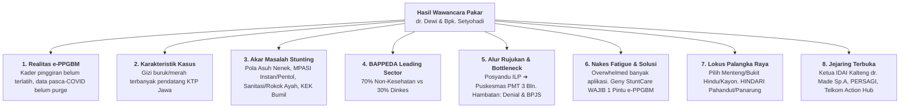
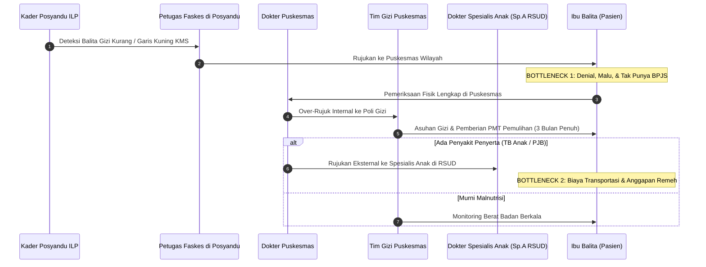
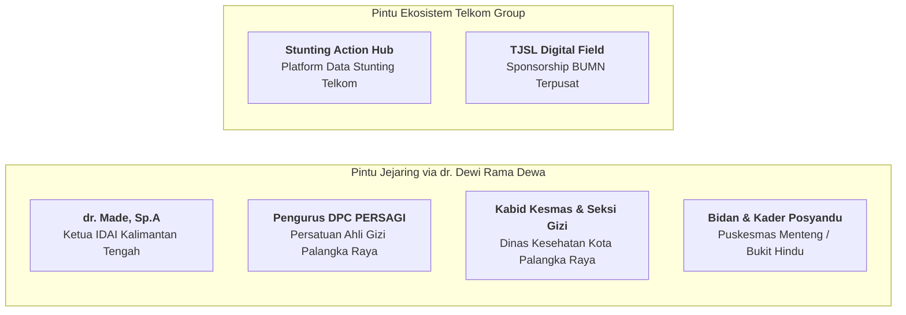

# 🎙️ NOTULENSI & RANGKUMAN KOMPREHENSIF HASIL WAWANCARA DEWAN PAKAR
## Konsultasi Strategis Bersama: dr. Dewi Rama Dewa, M.Kes. & Bapak Setyohadi
**Tautan Rekaman Resmi:** [YouTube Video - Wawancara dr. Dewi & Bpk. Setyohadi](https://youtu.be/-jGlQGCjEwI)  
**Tanggal Pelaksanaan:** Selasa–Rabu, 13–14 Oktober 2026  
**Durasi Diskusi:** ~1 Jam 3 Menit (Full Session)  
**Pewawancara / Notulis:** Gerrard Sebastian (Founder / Project Lead Geny StuntCare — Inkubasi BTP Telkom University)  
**Status Dokumen:** *Verified Expert Advisory Minutes — Highly Actionable*

---

## 👥 1. Profil Narasumber & Relasi Strategis

1. **dr. Dewi Rama Dewa, M.Kes.**
   * **Jabatan/Peran:** Pejabat Senior / Mantan Kepala Bidang Kesehatan Masyarakat (Kabid Kesmas) Dinas Kesehatan Kota Palangka Raya, Surveyor Akreditasi Puskesmas Kemenkes RI, Praktisi Medis Aktif (Dokter Umum & Penanggung Jawab Program Kesmas/Rematri).
   * **Keahlian Utama:** Kebijakan kesehatan publik daerah, regulasi Puskesmas/Posyandu ILP, alur rujukan gizi klinis, psikologi ibu balita rentan, dan audit operasional faskes primer.
2. **Bapak Setyohadi**
   * **Jabatan/Peran:** Senior Executive / Corporate Leader Telkom Group (Pakar Enterprise, Pemasaran Korporat & Kemitraan Digital).
   * **Keahlian Utama:** Tata kelola CSR/TJSL korporasi BUMN, ekosistem telekomunikasi nasional, data stunting Telkom (*Stunting Action Hub*), dan navigasi B2B/B2G.

---

## 🌟 2. Ringkasan Eksekutif (Executive Summary: 8 Temuan Kunci)

1. **Kendala Nyata e-PPGBM di Puskesmas:** Penginput data e-PPGBM adalah **petugas gizi puskesmas**, namun data mentahnya bergantung pada kader posyandu. Banyak kader baru pasca-COVID belum terlatih menimbang/mengukur tinggi badan. Terjadi masalah data: anak usia >5 tahun masih tercatat di sistem karena belum dibersihkan (*data purging*).
2. **Paradoks Balita Gizi Buruk Palangka Raya:** Kasus gizi buruk (*red line*) dan garis kuning KMS terbanyak di Kota Palangka Raya ternyata **bukan warga lokal Palangka Raya, melainkan kaum pendatang (terbanyak KTP Jawa)** yang bekerja di sektor informal/pasar. Warga lokal Palangka Raya rata-rata hanya mengalami gizi kurang ringan.
3. **5 Determinan Utama Stunting di Lapangan:** (a) Pola asuh nenek (bayi <6 bulan sudah disuapi makanan/buah); (b) MPASI tidak bergizi (disuapi pentol/cilok, kerupuk, mie instan, nugget/sosis berpengawet); (c) Lingkungan & sanitasi sungai + **paparan asap rokok ayah**; (d) Ibu hamil anemia/KEK (*under-educated*, pernikahan dini); (e) Peralihan dini ke susu formula.
4. **BAPPEDA Adalah *Leading Sector* (Proporsi 70% vs 30%):** Penanganan stunting **bukan hanya milik Dinas Kesehatan (hanya memegang porsi 30% intervensi spesifik)**. Sebanyak **70% intervensi sensitif dipegang BAPPEDA** yang mengoordinasikan Dinas PU (air bersih/jamban), Dinas Perikanan (gemar makan ikan), Pertanian/Peternakan (protein hewani), serta Kemenag/Diknas (pencegahan nikah dini SMP).
5. **Alur Rujukan Posyandu ILP & *Bottleneck*:** Posyandu kini berformat **ILP (Integrasi Layanan Primer)** lintas siklus hidup. Balita bermasalah dirujuk ke Puskesmas untuk asuhan gizi dan PMT Pemulihan selama 3 bulan. Jika ada penyakit penyerta (TB anak/PJB), baru dirujuk ke Spesialis Anak (Sp.A). *Bottleneck* terbesar: **Ibu *denial*/malu, tidak ada biaya transportasi, tidak punya BPJS, dan menganggap remeh anak kurus**.
6. **Kelelahan Nakes (*App Fatigue*):** Tenaga kesehatan menolak aplikasi baru karena sudah terbebani banyak aplikasi wajib (**e-PPGBM, ASIK Kemenkes, SIMPUS, Rematri**). **Geny StuntCare wajib mengadopsi model *One-Gate Integration* (terintegrasi langsung ke e-PPGBM/SatuSehat)** agar nakes cukup input sekali.
7. **Rekomendasi Lokus Percontohan Palangka Raya:** **Sangat direkomendasikan:** Puskesmas Menteng, Puskesmas Bukit Hindu, dan Puskesmas Kayon (masyarakat ASN/terpelajar, literasi digital tinggi). **Wajib dihindari:** Puskesmas Pahandut dan Puskesmas Panarung (masyarakat pedagang pasar/fluktuatif, sulit diajak taat sistem).
8. **Dukungan Validasi Jawa Timur Dulu (Fase 1):** dr. Dewi sangat menyetujui langkah Geny StuntCare yang berfokus validasi di **Jawa Timur terlebih dahulu** karena akses faskes mudah, geografis berdekatan, kader posyandu terlatih dan menerima uang transport (berbeda dengan Kalteng yang minim insentif kader dan geografis sungai/terisolir).

---

## 🔍 3. Pembedahan Mendalam Hasil Wawancara Per Topik

### A. Potret Riil e-PPGBM & Kesiapan Faskes Palangka Raya
* **Disparitas Pusat Kota vs Pinggiran:**
  * *Puskesmas Tengah Kota:* (Menteng, Pahandut, Bukit Hindu, Kayon) memiliki kader posyandu yang relatif terlatih dan terbiasa dengan pengukuran antropometri.
  * *Puskesmas Pinggiran:* (Marina Permai, Kereng Bangkirai, Kelampangan, Tangkiling, Rakumpit) menghadapi tantangan berat: wilayah kerja sangat luas, banyak kader posyandu baru pasca-COVID yang belum pernah dilatih mengukur tinggi badan dan menimbang bayi, sehingga akurasi data mentah sangat diragukan.
* **Inersia Data Pasca-Pandemi:** Data balita di e-PPGBM banyak yang sudah tidak akurat karena anak yang sudah lulus usia balita (>5 tahun) masih tercantum dalam daftar sasaran puskesmas pinggiran akibat ketiadaan pemutakhiran data berkala.

---

### B. Komparasi Tajam: Mengapa Jawa Timur Lebih Unggul untuk Validasi Fase 1?
dr. Dewi membeberkan disparitas mencolok antara Jawa Timur dan Kalimantan Tengah:
1. **Aksesibilitas & Kepadatan Wilayah:**
   * **Jawa Timur:** Pemukiman padat terpusat, akses jalan darat prima, relatif tidak ada wilayah terisolir yang membutuhkan perahu/kelotok air. Pengumpulan balita ke posyandu sangat mudah dipetakan.
   * **Kalimantan Tengah:** Geografis berjarak jauh (contoh: Tangkiling dan Rakumpit). Untuk melakukan imunisasi dan posyandu di daerah pedalaman (seperti pengalaman survei dr. Dewi di Arut Utara/Kobar), jarak sangat jauh, cakupan imunisasi rendah, dan transportasi air memakan biaya besar.
2. **Kesejahteraan & Insentif Kader:**
   * Di Jawa Timur, kader posyandu memperoleh **uang operasional/transport** yang jelas dari anggaran desa/kelurahan.
   * Di Palangka Raya/Kalteng, insentif kader sangat minim atau bahkan tidak ada transport, sehingga motivasi kader bergantung murni pada kerelaan sosial.
3. **Kesimpulan untuk Geny StuntCare:** Strategi tim untuk menuntaskan *Problem-Solution Fit* di Jawa Timur terlebih dahulu (Fase 1 bersama BTP Telkom University) adalah keputusan yang sangat rasional, tepat secara metodologi riset, dan mudah dimonitor.

---

### C. Fenomena Gizi Kurang & Pola Makan: "Pentol, Kerupuk, & Asap Rokok"
* **Demografi Kasus:**
  * Mayoritas balita gizi buruk (*red line* KMS) yang ditangani Dinas Kesehatan di Kota Palangka Raya berlatar belakang **kaum pendatang ber-KTP Jawa** yang merantau dan bekerja serabutan/di pasar.
  * Warga lokal suku Dayak di Palangka Raya umumnya tidak sampai mengalami gizi buruk ekstrem (*kwashiorkor*), melainkan berada di kategori gizi kurang ringan.
* **Kekeliruan Fatal Pola Asuh & MPASI (Akar Biologis Stunting):**
  1. *Intervensi Nenek:* Seringkali bayi usia 4 bulan sudah dipaksa makan buah/nasi lumat oleh neneknya karena menangis, merusak usus bayi dan menghentikan ASI eksklusif.
  2. *MPASI Instan & Pangan Olahan Rendah Gizi:* Balita usia 6–24 bulan diperkenalkan dengan makanan tidak bergizi: disuapi **pentol (cilok bakso), mie instan, kerupuk, sosis, dan nugget beku (*frozen food*)** berpengawet tinggi. Orang tua muda memilih yang praktis daripada memasak bahan segar lokal.
  3. *Bahaya Asap Rokok Ayah:* dr. Dewi menegaskan bahwa rumah dengan ayah perokok hampir dipastikan memiliki balita dengan pertumbuhan berat badan yang tersendat, sering sakit ISPA/diare, dan kurus karena paparan nikotin merusak nafsu makan dan penyerapan gizi anak.
  4. *Ibu Hamil "Kecabe-cabean" Under-educated:* Fenomena ibu muda usia belia (lulusan SMP akibat nikah dini) yang hamil tanpa kesiapan mental, mengalami anemia berat dan Kurang Energi Kronis (KEK) karena pola makan sembarangan (hanya suka makan seblak/bakso pedas) dan tidak mau kontrol ANC di Trimester 1 & 2.

---

### D. Birokrasi & Kebijakan: BAPPEDA Sebagai Nakhoda 70%
* dr. Dewi meluruskan miskonsepsi umum para periset startup: **Stunting bukan monopoli Dinas Kesehatan!**
* **Rumus Proporsi Intervensi Nasional:**
  * **30% Intervensi Spesifik (Dinkes):** PMT pemulihan, tablet tambah darah (Rematri), imunisasi, pemantauan antropometri puskesmas, dan rujukan klinis.
  * **70% Intervensi Sensitif (Non-Kesehatan dikoordinasi BAPPEDA):**
    * *Dinas PU:* Pembangunan sarana air bersih dan sanitasi jamban sehat (mengatasi jamban cemplung pinggir sungai Kahayan).
    * *Dinas Perikanan:* Kampanye gemar makan ikan lokal (ikan gabus/haruan, patin, baung).
    * *Dinas Pertanian & Peternakan:* Ketersediaan pasokan telur, daging ayam, dan sayuran segar murah.
    * *Kemenag & Dinas Pendidikan:* Advokasi pembatasan pernikahan usia dini (standar BKKBN: perempuan min. 21 tahun, laki-laki min. 25 tahun).
* **Implikasi untuk Geny StuntCare:** Saat mengajukan proposal tingkat kota (B2G), proposal tidak boleh hanya diajukan ke Dinkes, tetapi harus dipresentasikan di hadapan **BAPPEDA Kota** agar mendapat alokasi anggaran lintas dinas.

---

### E. SOP Resmi Alur Rujukan Puskesmas & Titik Bottleneck
SOP resmi alur penanganan balita di wilayah kerja Kota Palangka Raya saat ini mengikuti sistem **Posyandu ILP (Integrasi Layanan Primer)**:

* **Titik Sumpat (*Bottlenecks*) yang Kerap Terjadi:**
  1. *Parental Denial:* Ibu merasa tersinggung, malu, atau menyangkal anaknya kurang gizi.
  2. *Kendala Finansial & Administrasi:* Tidak memiliki jaminan BPJS Kesehatan aktif dan ketiadaan ongkos transportasi menuju puskesmas/rumah sakit.
  3. *Keterlambatan Fatal (Kasus Nyata):* Banyak orang tua baru membawa anaknya saat kondisi sudah dehidrasi parah (contoh kasus dr. Dewi: bayi diare 2 hari baru dibawa jam 14.00 siang saat puskesmas tutup rawat jalan, tanpa BPJS, sehingga terpaksa dilarikan langsung ke IGD RS).

---

### F. Aplikasi Kesehatan: Fenomena *App Fatigue* & Kunci Adopsi Nakes
* Tenaga kesehatan puskesmas sudah sangat kewalahan menginput data ke berbagai sistem pemerintah:
  * **e-PPGBM:** Inputan tumbuh kembang balita oleh nutrisionis puskesmas.
  * **ASIK (Aplikasi Sehat IndonesiaKu):** Inputan skrining imunisasi dan PTM dari Kemenkes.
  * **SIMPUS:** Sistem internal pelayanan rawat jalan puskesmas.
  * **Rematri:** Aplikasi pelaporan minum tablet tambah darah remaja putri di sekolah.
* **Petuah Keras dr. Dewi untuk Tim IT Geny StuntCare:**
  > *"Jangan pernah menambah beban nakes dengan aplikasi baru yang mereka harus ketik ulang! Kunci diterimanya Geny StuntCare adalah **TERINTEGRASI LANGSUNG (One-Gate Integration)** ke e-PPGBM atau SatuSehat Kemenkes. Jika aplikasi kalian bisa diisi mandiri oleh ibu balita di rumah atau kader posyandu, lalu datanya langsung mengalir sinkron ke e-PPGBM tanpa nakes harus mengetik ulang, nakes pasti akan menyambut dengan gembira."*

---

### G. Pemilihan Lokus Pilot Project Palangka Raya (Fase 2)
dr. Dewi membagi puskesmas di Palangka Raya menjadi dua kutub:

| Kategori Faskes | Nama Puskesmas | Karakteristik Demografi | Rekomendasi dr. Dewi |
| :--- | :--- | :--- | :--- |
| **Zona Rekomendasi Emas (*High Readiness*)** | **Puskesmas Menteng, Bukit Hindu, Kayon (Rajawali)** | Mayoritas penduduk ASN, pegawai swasta, dan kaum terpelajar (lulusan SMP ke atas). Melek smartphone, kooperatif, dan kader terlatih. | **SANGAT DIREKOMENDASIKAN untuk Pilot Project Percontohan.** |
| **Zona Merah (*High Resistance*)** | **Puskesmas Pahandut & Panarung** | Mayoritas masyarakat pasar (pedagang Banjar / pekerja serabutan). Mobilitas tinggi, tidak tertib jadwal posyandu, resisten terhadap edukasi formal. | **HINDARI untuk tahap awal; tingkat kegagalan kepatuhan tinggi.** |
| **Zona Pinggiran (*High Burden*)** | **Marina Permai, Kereng Bangkirai, Tangkiling, Rakumpit** | Wilayah kerja sangat luas, banyak kawasan perairan/sungai, banyak kader posyandu baru yang belum terlatih. | **Simpan untuk tahap ekspansi setelah sistem terbukti stabil.** |

---

## 🤝 4. Pintu Jejaring Strategis yang Resmi Terbuka (*Network Unlocked*)

Hasil wawancara ini berhasil membuka akses langsung ke stakeholder kunci:

1. **dr. Made, Sp.A (Ketua IDAI Kalimantan Tengah):** dr. Dewi bersedia memfasilitasi pertemuan langsung dengan dr. Made untuk konsultasi algoritma medis rujukan anak dan red-flags stunting.
2. **Pengurus PERSAGI (Persatuan Ahli Gizi Indonesia) Palangka Raya:** Untuk validasi saintifik formula MPASI padat kalori berbahan pangan lokal.
3. **Kepala Seksi Gizi & Mantan Rekan Kerja di Dinkes Kota Palangka Raya:** Membantu proses birokrasi proposal pilot project inovasi daerah.
4. **Bidan Koordinator & Nutrisionis Puskesmas Menteng/Bukit Hindu:** Calon mitra pengujian lapangan (*field testing*).
5. **Jejaring Pakar di Jawa Timur:** dr. Dewi merekomendasikan untuk meminta rekomendasi langsung ke **Prof. Dr. Heti Ira Ayue** yang memiliki riwayat doktoral S3 di Universitas Brawijaya Malang dan pergaulan riset luas di Jawa Timur.
6. **Catatan Khusus Jalur PKK:** dr. Dewi menyarankan **tidak perlu masuk lewat Ketua Tim Penggerak PKK Kota (Ibu Walikota)** karena proses birokrasinya berbelit dan kurang efektif, melainkan langsung menyasar **kader posyandu dan bidan di tingkat kelurahan**.

---

## 📡 5. Perspektif Bapak Setyohadi & Ekosistem Telkom Group

1. **Stunting Action Hub Telkom:**
   * Telkom Group telah memiliki inisiatif platform data stunting bernama **Stunting Action Hub** berbasis web.
   * Geny StuntCare dapat menjajaki kolaborasi data penanganan stunting dengan Telkom untuk pelatihan model AI (*AI model training*).
2. **Kondisi Yakes Telkom:**
   * Yayasan Kesehatan Telkom (Yakes) **sudah tidak beroperasi di Palangka Raya**, sehingga validasi korporat Yakes harus dialihkan ke kantor Regional V Jawa Timur atau Regional Telkom terdekat di Jawa.
3. **Pola Pendanaan CSR / TJSL BUMN:**
   * Kebijakan dana CSR/TJSL Telkom saat ini **bersifat sentralisasi (*one-door centralized*)** dari kantor pusat Telkom, bukan diputuskan di kantor daerah.
   * Alokasi CSR BUMN saat ini diprioritaskan untuk program berbasis **kapabilitas digital (*digital field/digital capability*)**, yang sangat selaras dengan proposal teknologi Geny StuntCare.

---

## 💡 6. Wawasan Karier Riset & Dimensi Psikologis Ibu

### A. Petuah Karier: Lapangan Terlebih Dahulu Sebelum S2/S3
* dr. Dewi memberikan nasihat karier mendalam bagi Gerrard:  
  * Jangan terburu-buru mengambil jenjang S2/S3 secara teoritis tanpa mencicipi dunia kerja lapangan terlebih dahulu (mengambil pelajaran dari kasus rekan-rekan yang langsung S2 namun sulit beradaptasi di industri).
  * Terjun langsung ke lapangan (misalnya mendampingi nakes di puskesmas, melihat langsung keribetan input data e-PPGBM, dan menghadapi ibu balita secara langsung) akan membuat riset S2/S3 kelak menjadi sangat matang, realistis, dan tepat sasaran.
  * Jalur kompetisi startup inkubasi BTP saat ini adalah wahana terbaik untuk mengasah insting lapangan tersebut.

### B. Dimensi Psikologis Ibu & Kemitraan Mahasiswa Psikologi
* Stunting bukan semata masalah biologi dan makanan, melainkan masalah **kejiwaan dan penerimaan (*acceptance*) seorang ibu**:
  * Ibu muda yang hamil di luar ikatan resmi atau ditinggal pasangannya kerap mengalami depresi, menolak kehamilannya (*pregnancy rejection*), dan menelantarkan asupan nutrisi sejak Trimester 1 & 2.
  * dr. Dewi sangat mendukung gagasan Geny StuntCare untuk berkolaborasi dengan mahasiswa **Fakultas Psikologi** atau mahasiswa **Poltekkes (Praktek Belajar Lapangan/PBL)** guna menyusun modul edukasi *bonding* ibu-anak dan kesiapan mental kehamilan.

---

## 🎯 7. Matriks Tindak Lanjut Aksi Proyek (*Project Action Plan*)

| Aspek Produk / Riset | Temuan Lapangan dari Wawancara | Penyesuaian Aksi pada Geny StuntCare |
| :--- | :--- | :--- |
| **Arsitektur Data & Integrasi** | Nakes lelah dengan banyaknya aplikasi (*app fatigue*). | Rancang fitur ekspor 1-klik yang format tabelnya sudah 100% klop dengan kolom impor e-PPGBM. Prioritaskan integrasi SatuSehat Kemenkes. |
| **Formulasi Resep MPASI** | Banyak balita diberi pentol, sosis, nugget berpengawet, dan bumbu penyedap sintetis berlebih. | Sediakan katalog "MPASI Sehat Padat Kalori Segar" alternatif nugget/pentol homemade berbahan ikan lokal (gabus/patin/lele) dan telur tanpa pengawet. |
| **Kriteria Skrining Anamnesis** | Asap rokok ayah dan riwayat KEK ibu hamil terbukti menjadi pemicu utama faltering. | Tambahkan variabel wajib pada form asesmen risiko: "Apakah anggota keluarga serumah merokok?" dan "Riwayat BB lahir & lingkar lengan atas (LILA) ibu". |
| **Lokus Uji Coba Lapangan** | Jawa Timur terkonfirmasi paling siap secara logistik, faskes, dan insentif kader. | Kunci 100% fokus validasi lapangan Stage 1 BTP di **Jawa Timur (Fase 1)**. Tetapkan **Puskesmas Menteng / Bukit Hindu** sebagai calon lokus Fase 2 di Palangka Raya. |
| **Jejaring Medis Lanjutan** | Terbukanya akses ke Ketua IDAI Kalteng dan PERSAGI. | Jadwalkan permohonan wawancara lanjutan dengan **dr. Made, Sp.A** (Ketua IDAI Kalteng) dan pakar gizi PERSAGI untuk audit red-flags aplikasi. |

---

  <em>Notulensi ini diverifikasi secara penuh berdasarkan rekaman wawancara audio-visual 14 Oktober 2026 sebagai aset intelijen primer pengembangan platform Geny StuntCare.</em>

