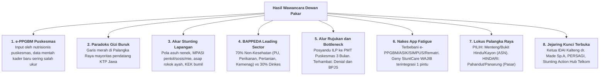
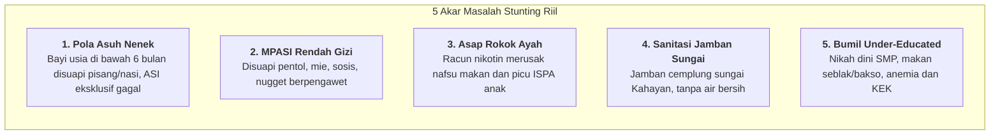
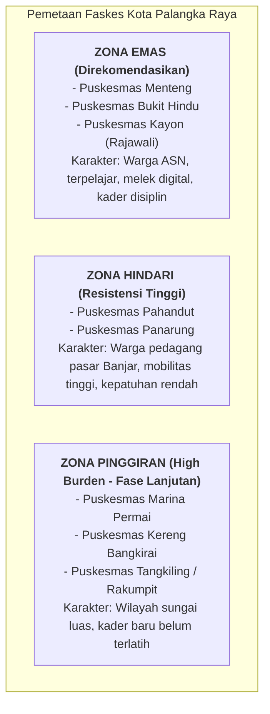
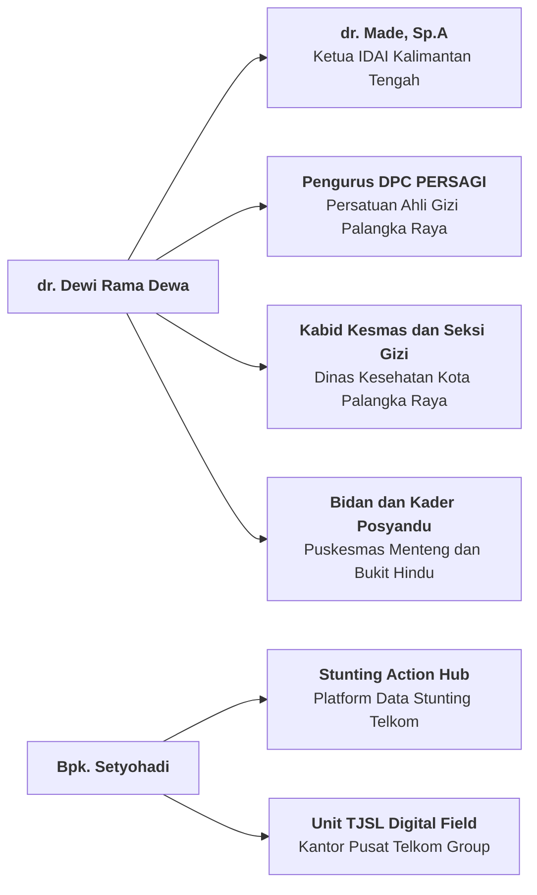

# 📝 NOTULENSI RESMI & RANGKUMAN EKSEKUTIF HASIL WAWANCARA DEWAN PAKAR
## Sesi Konsultasi Mendalam: dr. Dewi Rama Dewa, M.Kes. & Bapak Setyohadi
### Validasi Lapangan Kebijakan Faskes, Alur Rujukan Posyandu ILP, dan Sinergi Enterprise BUMN
**Program Inkubasi Bisnis Startup Batch 24 — Bandung Techno Park (Telkom University)**

---

  
  
  
  
  
  

---

## 📌 1. Metadata Wawancara & Tautan Rekaman

| Parameter | Keterangan Rinci |
| :--- | :--- |
| **Topik Konsultasi** | Validasi Lapangan Kebijakan Stunting, Alur Rujukan Posyandu ILP, e-PPGBM, Kesiapan Faskes Jatim vs Kalteng, serta Potensi Sinergi CSR/Data Telkom |
| **Waktu Pelaksanaan** | Selasa–Rabu, 13–14 Oktober 2026 |
| **Durasi Wawancara** | **1 Jam 3 Menit 5 Detik** (01:03:05) |
| **Tautan Rekaman Resmi** | 🎥 **[YouTube: Wawancara dr. Dewi Rama Dewa & Bpk. Setyohadi](https://youtu.be/-jGlQGCjEwI)** |
| **Narasumber 1** | **dr. Dewi Rama Dewa, M.Kes.** (Pejabat Senior / Mantan Kabid Kesmas Dinkes Kota Palangka Raya, Surveyor Akreditasi Puskesmas Kemenkes, Praktisi Dokter Umum) |
| **Narasumber 2** | **Bapak Setyohadi** (Senior Corporate Leader Telkom Group, Pakar Pemasaran Enterprise & Kemitraan Digital, Suami dr. Dewi Rama Dewa) |
| **Pewawancara / Notulis** | **Gerrard Sebastian** (Founder / Project Lead Geny StuntCare — Mahasiswa Telkom University Surabaya & Tenant BTP) |
| **Status Temuan** | *Primary Ground-Truth Intelligence* — Diverifikasi dari rekaman audio-visual asli |

---

## 📑 Daftar Isi Cepat (*Table of Contents*)

1. [Peta Navigasi & Indeks Cap Waktu (Timestamps)](#-2-peta-navigasi--indeks-cap-waktu-timestamps)
2. [Ringkasan Eksekutif (8 Temuan Kunci Lapangan)](#-3-ringkasan-eksekutif-8-temuan-kunci-lapangan)
3. [Pembedahan 10 Topik Pembahasan Utama](#-4-pembedahan-10-topik-pembahasan-utama)
   * [3.1. Realitas e-PPGBM & Disparitas Puskesmas Kota vs Pinggiran](#31-realitas-e-ppgbm--disparitas-puskesmas-kota-vs-pinggiran)
   * [3.2. Komparasi Empiris: Jawa Timur vs Kalimantan Tengah](#32-komparasi-empiris-jawa-timur-vs-kalimantan-tengah)
   * [3.3. Karakteristik Kasus: Paradoks Balita Gizi Buruk Pendatang KTP Jawa](#33-karakteristik-kasus-paradoks-balita-gizi-buruk-pendatang-ktp-jawa)
   * [3.4. 5 Akar Determinan Stunting Lapangan: Pola Asuh Nenek, Pentol, & Rokok Ayah](#34-5-akar-determinan-stunting-lapangan-pola-asuh-nenek-pentol--rokok-ayah)
   * [3.5. Tata Kelola Kebijakan: BAPPEDA Sebagai Leading Sector 70% vs Dinkes 30%](#35-tata-kelola-kebijakan-bappeda-sebagai-leading-sector-70-vs-dinkes-30)
   * [3.6. SOP Alur Rujukan Posyandu ILP & Titik Sumpat (Bottlenecks)](#36-sop-alur-rujukan-posyandu-ilp--titik-sumpat-bottlenecks)
   * [3.7. Evaluasi Produk Geny StuntCare: App Fatigue Nakes & Wajib Integrasi 1 Pintu](#37-evaluasi-produk-geny-stuntcare-app-fatigue-nakes--wajib-integrasi-1-pintu)
   * [3.8. Rekomendasi Lokus Faskes Palangka Raya: Zona Emas vs Zona Hindari](#38-rekomendasi-lokus-faskes-palangka-raya-zona-emas-vs-zona-hindari)
   * [3.9. Perspektif Bapak Setyohadi: Stunting Action Hub & CSR Telkom Sentralisasi](#39-perspektif-bapak-setyohadi-stunting-action-hub--csr-telkom-sentralisasi)
   * [3.10. Dimensi Psikologis Ibu & Kemitraan Fakultas Psikologi/Poltekkes](#310-dimensi-psikologis-ibu--kemitraan-fakultas-psikologipoltekkes)
4. [Daftar Pintu Relasi & Jaringan yang Terbuka (*Network Unlocked*)](#-5-daftar-pintu-relasi--jaringan-yang-terbuka-network-unlocked)
5. [Petuah Karier & Metodologi Riset S2/S3](#-6-petuah-karier--metodologi-riset-s2s3)
6. [Matriks Aksi Penyesuaian Produk Geny StuntCare](#-7-matriks-aksi-penyesuaian-produk-geny-stuntcare)
7. [Checklist Verifikasi Lembar Kendali Pasca-Meeting](#-8-checklist-verifikasi-lembar-kendali-pasca-meeting)

---

## ⏱️ 2. Peta Navigasi & Indeks Cap Waktu (*Timestamps*)

Berikut adalah indeks penanda waktu langsung ke rekaman video YouTube untuk memudahkan verifikasi audio-visual:

| Cap Waktu (*Timestamp*) | Topik / Diskusi Kunci yang Dibahas | Narasumber Utama |
| :---: | :--- | :---: |
| **00:00 – 01:10** | Pembukaan, sambutan hangat, dan kesediaan dr. Dewi membantu akses ke staf Dinkes | dr. Dewi |
| **01:11 – 03:39** | Realitas e-PPGBM di Puskesmas: kader baru belum terlatih & data balita pasca-COVID belum purge | dr. Dewi |
| **03:40 – 05:00** | Komparasi geografis faskes & akses balita: Jawa Timur vs Kalimantan Tengah (daerah sungai/kelotok) | dr. Dewi |
| **05:01 – 06:40** | Demografi balita gizi buruk Palangka Raya: terbanyak kaum pendatang KTP Jawa | dr. Dewi |
| **06:41 – 11:55** | Akar stunting di lapangan: intervensi nenek, MPASI pentol/mie/kerupuk, sanitasi, & asap rokok ayah | dr. Dewi |
| **11:56 – 13:00** | Bahaya makanan beku berpengawet (*frozen food*), bumbu penyedap sintetis vs MSG murni | dr. Dewi |
| **13:01 – 14:30** | Disparitas kader Posyandu: Jawa Timur dapat uang transport vs Palangka Raya tanpa transport | dr. Dewi |
| **14:31 – 17:40** | **BAPPEDA sebagai Leading Sector penanganan stunting (70% non-kesehatan vs 30% Dinkes)** | dr. Dewi |
| **17:41 – 20:30** | SOP alur rujukan Posyandu ILP: Kader ➔ Petugas Posyandu ➔ Dokter ➔ Poli Gizi (PMT 3 Bulan) ➔ Sp.A | dr. Dewi |
| **20:31 – 23:40** | Titik sumbat rujukan (*bottlenecks*): ibu denial, malu, tak punya BPJS, transport, & kasus nyata diare | dr. Dewi |
| **23:41 – 27:30** | *App Fatigue* Nakes (e-PPGBM, ASIK, SIMPUS, Rematri) & **Solusi Geny StuntCare wajib 1 pintu** | dr. Dewi |
| **27:31 – 30:00** | Rekomendasi Lokus Palangka Raya: **PILIH Menteng, Bukit Hindu, Kayon**; HINDARI Pahandut & Panarung | dr. Dewi |
| **30:01 – 32:20** | **Membuka Relasi:** Ketua IDAI Kalteng (dr. Made, Sp.A), PERSAGI, dan pengalihan relasi Jatim ke Prof. Heti | dr. Dewi |
| **32:21 – 39:00** | Nasihat karier: pentingnya jam terbang lapangan sebelum lanjut S2/S3 (pelajaran dari kasus rekan) | dr. Dewi |
| **39:01 – 42:30** | Budaya makan suku Dayak (juhu, wadi, pakasam), habit tradisional, & persetujuan fokus Jawa Timur | dr. Dewi |
| **42:31 – 47:50** | Dinamika kampus, sharing keluarga, dan motivasi perjalanan akademik | dr. Dewi & Gerrard |
| **47:51 – 50:20** | **Perspektif Bpk. Setyohadi:** Stunting Action Hub Telkom, CSR sentralisasi digital, & status Yakes | Bpk. Setyohadi |
| **50:21 – 52:10** | Pengalaman survei faskes 3T (Arut Utara Kobar): kendala imunisasi dan jarak tempuh | dr. Dewi |
| **52:11 – 57:00** | Dimensi psikologis ibu hamil muda, penolakan kehamilan (*unwanted pregnancy*), & saran kolaborasi Psikologi | dr. Dewi |
| **57:01 – 01:03:05** | Obrolan penutup, sharing santai keluarga, dan penegasan kesiapan tindak lanjut kemitraan | dr. Dewi & Gerrard |

---

## 🌟 3. Ringkasan Eksekutif (8 Temuan Kunci Lapangan)

1. **e-PPGBM Puskesmas Butuh Data Mentah Bersih:** Penginput e-PPGBM adalah petugas gizi puskesmas, tetapi data penimbangan dari posyandu pinggiran kerap bias karena banyak kader baru pasca-COVID belum terlatih. Data balita juga belum di-purge (anak >5 tahun masih tercatat).
2. **Karakteristik Kasus Palangka Raya:** Kasus gizi buruk (*red line*) di Kota Palangka Raya terbanyak dialami **pendatang ber-KTP Jawa** yang bekerja di sektor informal/pasar. Warga lokal rata-rata hanya gizi kurang ringan.
3. **Penyebab Biologis Utama:** Campur tangan nenek (bayi <6 bulan disuapi makanan/buah), MPASI instan rendah gizi (**pentol, sosis, nugget beku, kerupuk, mie instan**), sanitasi jamban sungai, serta **paparan asap rokok ayah** yang menghambat laju tumbuh anak.
4. **BAPPEDA Memegang 70% Intervensi:** Dinas Kesehatan hanya memegang 30% (intervensi spesifik). Sebanyak 70% intervensi sensitif dikoordinasi BAPPEDA melalui Dinas PU, Perikanan, Pertanian, Peternakan, serta Kemenag/Diknas (pencegahan nikah dini SMP).
5. **Alur Posyandu ILP & Bottlenecks:** Posyandu kini terintegrasi lintas usia (ILP). Balita faltering dirujuk ke Puskesmas untuk evaluasi asuhan gizi dan PMT Pemulihan 3 bulan. Bottleneck terbesar: **ibu denial/malu, tidak ada biaya transportasi, tidak punya BPJS aktif, dan menganggap remeh anak kurus**.
6. **Kelelahan Nakes (*App Fatigue*):** Nakes menolak aplikasi terpisah karena lelah menginput e-PPGBM, ASIK, SIMPUS, dan Rematri. **Geny StuntCare wajib mengadopsi model terintegrasi 1-pintu ke e-PPGBM/SatuSehat**.
7. **Lokus Uji Coba Terpilih:** **Puskesmas Menteng, Bukit Hindu, dan Kayon** (warga ASN/terpelajar, kader tertib). Hindari **Puskesmas Pahandut dan Panarung** (pedagang pasar, kepatuhan rendah).
8. **Dukungan Penuh Fokus Jawa Timur (Fase 1):** dr. Dewi sangat mendukung validasi di Jawa Timur terlebih dahulu karena pemukiman padat, akses darat mudah, kader menerima uang transport, dan fasilitas faskes jauh lebih maju.

---

## 🔍 4. Pembedahan 10 Topik Pembahasan Utama

### 4.1. Realitas e-PPGBM & Disparitas Puskesmas Kota vs Pinggiran
* **Mekanisme Pelaporan:** Petugas gizi puskesmas tidak menimbang sendiri seluruh balita di lapangan. Mereka mengandalkan data mentah dari buku kader posyandu.
* **Tantangan Kader Pasca-COVID:** Regenerasi kader posyandu membuat banyak kader senior berhenti. Kader pengganti yang baru belum memperoleh pelatihan standar antropometri Kemenkes (posisi penimbangan dacin/digital dan pengukuran panjang badan terlentang masih sering salah).
* **Disparitas Wilayah:**
  * *Puskesmas Perkotaan (Menteng, Bukit Hindu, Kayon, Pahandut):* Kader relatif terlatih dan terbiasa dengan evaluasi KMS.
  * *Puskesmas Pinggiran (Marina Permai, Kereng Bangkirai, Tangkiling, Rakumpit):* Wilayah kerja teramat luas, balita tersebar di pondok-pondok ladang/sungai, dan data balita di e-PPGBM belum diperbarui sejak pandemi COVID-19.

---

### 4.2. Komparasi Empiris: Jawa Timur vs Kalimantan Tengah
dr. Dewi membeberkan fakta lapangan mengapa Jawa Timur adalah medan uji coba (*proving ground*) yang paling tepat untuk Stage 1 BTP:

| Parameter Komparasi | Jawa Timur (Lokus Validasi Fase 1) | Kalimantan Tengah (Lokus Replikasi Fase 2) |
| :--- | :--- | :--- |
| **Aksesibilitas Geografis** | Pemukiman padat, jalan darat terhubung rapat, tidak ada daerah terisolir perahu. | Jarak antar-kecamatan sangat jauh, daerah aliran sungai (DAS) membutuhkan transportasi perahu/kelotok air. |
| **Kesejahteraan Kader** | Kader Posyandu memperoleh **uang operasional / uang transport desa**. | Kader Posyandu **tidak memperoleh uang transport**, motivasi murni kerelaan sosial. |
| **Literasi & Infrastruktur Digital** | Penetrasi 4G/5G merata, kader terbiasa dengan gawai pintar dan aplikasi kelurahan. | Kerap terjadi *blank spot* di pinggiran sungai dan perkebunan; kader posyandu pinggiran gagap teknologi. |
| **Kelengkapan Faskes** | Faskes primer dan sekunder lengkap, puskesmas berdekatan dengan RS rujukan. | Faskes terbatas, puskesmas pedalaman (seperti Arut Utara) sulit mencapai target imunisasi dasar. |

---

### 4.3. Karakteristik Kasus: Paradoks Balita Gizi Buruk Pendatang KTP Jawa
* **Temuan Kontraintuitif:** Di Kota Palangka Raya, kasus balita yang jatuh ke **garis merah KMS atau gizi buruk berat (*marasmus/kwashiorkor*) ternyata didominasi oleh keluarga pendatang ber-KTP Jawa** yang merantau tanpa kepastian pekerjaan tetap (buruh pasar/serabutan).
* **Karakter Warga Lokal Dayak:** Warga asli Palangka Raya umumnya berada di rentang **gizi kurang ringan**, jarang sekali yang sampai gizi buruk ekstrem karena masih memiliki jaring pengaman keluarga dan ketersediaan ikan sungai lokal.

---

### 4.4. 5 Akar Determinan Stunting Lapangan: Pola Asuh Nenek, Pentol, & Rokok Ayah
dr. Dewi merumuskan 5 akar penyebab stunting yang paling sering ditemukan di ruang periksa:

1. **Intervensi Pola Asuh Nenek:** Di banyak keluarga, nenek memegang kendali pengasuhan. Bayi baru berusia 4 bulan yang menangis langsung disuapi pisang atau nasi lumat dengan dalih "anaknya kelaparan", yang mengakibatkan mikrolesi usus bayi dan kegagalan ASI eksklusif.
2. **MPASI Instan & Pangan Olahan Berpengawet:** Ibu-ibu muda enggan memasak makanan segar (*fresh food*). Balita usia 6–24 bulan diberi jajanan pasar seperti **pentol (bakso cilok), kerupuk, mie instan, sosis, dan nugget beku (*frozen food*)** yang sarat natrium, pengawet, dan bumbu penyedap sintetis berlebih.
3. **Paparan Asap Rokok Ayah (Faktor Determinan Kuat):** dr. Dewi menegaskan korelasi klinis kuat: *"Jika bapaknya merokok di dalam rumah, anak hampir dipastikan sulit naik berat badannya, sering batuk pilek/diare, dan pertumbuhannya terhambat."*
4. **Sanitasi Lingkungan Buruk:** Pemukiman di bantaran sungai Kahayan masih menggunakan jamban cemplung yang kotorannya langsung terbuang ke sungai, tanpa akses air bersih yang memadai.
5. **Ibu Hamil Muda yang *Under-Educated*:** Akibat pernikahan usia dini (lulusan SMP), calon ibu tidak memahami pentingnya asupan gizi 1000 Hari Pertama Kehidupan (HPK). Selama hamil Trimester 1 & 2 hanya menuruti nafsu makan cemilan pedas (seblak/bakso), mengalami anemia berat dan Kurang Energi Kronis (KEK), serta tidak pernah memeriksakan kehamilan ke dokter/bidan.

---

### 4.5. Tata Kelola Kebijakan: BAPPEDA Sebagai Leading Sector 70% vs Dinkes 30%
* **Dinkes Bukan Pemimpin Tunggal:** Penurunan stunting memerlukan intervensi multi-sektor (*Penta-Helix*).
* **Pembagian Porsi Nasional:**
  * **30% Intervensi Spesifik (Dinas Kesehatan):** Pemberian makanan tambahan (PMT) pemulihan, tablet tambah darah remaja putri (Rematri), imunisasi, pemantauan antropometri, dan rujukan klinis.
  * **70% Intervensi Sensitif (BAPPEDA mengoordinasi lintas dinas):**
    * *Dinas Pekerjaan Umum (PU):* Pembangunan infrastruktur sanitasi jamban sehat komunal dan pipanisasi air bersih.
    * *Dinas Perikanan:* Program gerakan memasyarakatkan makan ikan (Gemarikan) komoditas air tawar lokal.
    * *Dinas Pertanian & Peternakan:* Stabilisasi ketersediaan pasokan telur, daging ayam, dan sayuran murah.
    * *Kemenag & Dinas Pendidikan:* Edukasi pencegahan pernikahan usia anak di tingkat SMP/SMA.
* **Strategi B2G Geny StuntCare:** Proposal kemitraan inovasi daerah wajib diajukan ke **BAPPEDA Kota** agar dapat dianggarkan secara formal melalui dokumen Rencana Aksi Daerah (RAD) dan musrenbang.

---

### 4.6. SOP Alur Rujukan Posyandu ILP & Titik Sumpat (*Bottlenecks*)
* **Alur Baku Penanganan:**
  1. Penimbangan di Posyandu ILP menemukan balita di garis kuning atau garis merah KMS.
  2. Dilaporkan ke petugas puskesmas yang mendampingi posyandu hari itu.
  3. Dirujuk ke Puskesmas induk untuk pemeriksaan fisik dokter.
  4. Over-rujuk internal ke Poli Gizi: dilakukan asuhan gizi dan pemberian **PMT Pemulihan selama 3 bulan penuh berturut-turut**.
  5. Jika dalam 3 bulan berat badan tidak naik atau terindikasi penyakit kronis (TB anak / penyakit jantung bawaan), dokter puskesmas menerbitkan rujukan ke **Dokter Spesialis Anak (Sp.A)** di RSUD.
* **Titik Sumpat Utama di Lapangan:**
  * *Ibu Denial & Malu:* Orang tua menolak datang ke puskesmas karena merasa terhakimi atau malu status gizinya diketahui tetangga.
  * *Ketiadaan Jaminan BPJS:* Banyak keluarga miskin/pendatang tidak memiliki BPJS Kesehatan aktif sehingga takut dibebani biaya rawat inap/jalan.
  * *Ketiadaan Transportasi:* Tidak ada anggota keluarga yang bersedia mengantar ibu ke puskesmas/rumah sakit.
  * *Sikap Meremehkan (Ignorance):* Orang tua beranggapan wajar jika balita kurus ("dulu waktu kecil saya juga kurus dan susah makan, tapi sekarang besar sehat saja").

---

### 4.7. Evaluasi Produk Geny StuntCare: *App Fatigue* Nakes & Wajib Integrasi 1 Pintu
* **Keluhan Nakes Lapangan:** Nakes puskesmas sudah kelelahan (*burnout*) menginput laporan ke berbagai aplikasi wajib Kemenkes:
  * **e-PPGBM:** Pencatatan tumbuh kembang balita bulanan.
  * **ASIK:** Aplikasi Sehat IndonesiaKu untuk skrining posyandu.
  * **SIMPUS:** Sistem informasi rekam medis internal puskesmas.
  * **Rematri:** Aplikasi laporan tablet tambah darah remaja putri di sekolah.
* **Kaidah Emas untuk Geny StuntCare:**
  > *"Nakes pasti menolak jika ada aplikasi baru yang mewajibkan mereka menginput ulang data. Kunci keberhasilan Geny StuntCare adalah **INTEGRASI SATU PINTU (One-Gate Integration)**. Aplikasi digunakan mandiri oleh ibu balita di rumah atau kader posyandu, lalu sistem secara otomatis menyediakan tombol ekspor data yang format kolomnya persis sesuai e-PPGBM atau terhubung via API SatuSehat Kemenkes."*

---

### 4.8. Rekomendasi Lokus Faskes Palangka Raya: Zona Emas vs Zona Hindari
dr. Dewi memberikan panduan pemilihan lokasi uji coba percontohan di Kota Palangka Raya (Fase 2):

---

### 4.9. Perspektif Bapak Setyohadi: Stunting Action Hub & CSR Telkom Sentralisasi
* **Stunting Action Hub Milik Telkom:**
  * Telkom Group telah memiliki platform web internal bernama **Stunting Action Hub** yang berfokus pada agregasi data stunting.
  * Geny StuntCare dapat menjajaki kerja sama pemanfaatan data agregat stunting Telkom untuk validasi dan pelatihan model kecerdasan buatan (*AI model training*).
* **Tata Kelola CSR / TJSL Telkom Terkini:**
  * Penganggaran program CSR Telkom saat ini **bersifat sentralisasi penuh (*one-door centralized*)** di kantor pusat Telkom, bukan lagi di kantor wilayah/daerah.
  * Alokasi CSR BUMN saat ini diprioritaskan untuk inisiatif berbasis **kapabilitas digital (*digital field/digital capability*)**, yang sangat selaras dengan produk inovasi mHealth Geny StuntCare.
* **Kondisi Yakes Telkom:**
  * Unit Yayasan Kesehatan Telkom (Yakes) **sudah tidak beroperasi di Palangka Raya**, sehingga validasi *B2B Corporate Wellness* dialihkan ke kantor Telkom Regional V Jawa Timur (Surabaya/Malang).

---

### 4.10. Dimensi Psikologis Ibu & Kemitraan Fakultas Psikologi/Poltekkes
* Stunting memiliki akar psikologis yang dalam:
  * Kasus kehamilan tidak direncanakan (*unwanted pregnancy*) pada ibu muda di luar ikatan pernikahan kerap memicu **penolakan kehamilan (*pregnancy rejection*)**. Ibu mengalami depresi, mengabaikan asupan nutrisi trimester awal, dan tidak memiliki ikatan batin (*bonding*) dengan bayinya saat lahir.
* **Rekomendasi Kolaborasi:** Geny StuntCare sangat disarankan bermitra dengan mahasiswa **Fakultas Psikologi** atau mahasiswa **Poltekkes (program Praktek Belajar Lapangan/PBL)** untuk menyusun modul konseling empati, kesiapan mental menjadi orang tua, dan pola asuh penuh kasih sayang (*responsive feeding*).

---

## 🤝 5. Daftar Pintu Relasi & Jaringan yang Terbuka (*Network Unlocked*)

Sesi wawancara ini berhasil membuka kontak langsung dengan para penentu kebijakan kesehatan:

1. **dr. Made, Sp.A (Ketua IDAI Kalteng):** dr. Dewi bersedia memfasilitasi pertemuan langsung dengan dr. Made untuk mengaudit algoritma rujukan klinis dan batasan *red-flags* balita faltering.
2. **Pengurus PERSAGI Kota Palangka Raya:** Untuk validasi saintifik formula MPASI padat kalori berbahan ikan air tawar lokal.
3. **Mantan Staf / Seksi Gizi Dinkes Palangka Raya:** Membantu proses birokrasi penyusunan proposal percontohan faskes daerah.
4. **Bidan Koordinator Puskesmas Menteng / Bukit Hindu:** Calon mitra pengujian faskes primer.
5. **Jejaring Pakar Jawa Timur:** Dialihkan dan dimaksimalkan melalui **Prof. Dr. Heti Ira Ayue** (Dosen Poltekkes / S3 Kedokteran UB Malang).
6. **Catatan Jalur PKK:** Disarankan **tidak melalui Ketua TP-PKK Kota (Ibu Walikota)** karena kendala birokrasi dan efektivitas lapangan; lebih efektif langsung menyasar kader posyandu dan bidan faskes.

---

## 🎓 6. Petuah Karier & Metodologi Riset S2/S3
dr. Dewi memberikan nasihat karier berharga bagi Gerrard Sebastian:
* **Pengalaman Kerja Lapangan Sebelum S2/S3:** Mengambil pelajaran dari berbagai kasus kolega yang langsung melanjutkan S2/S3 tanpa pengalaman kerja praktis, mereka seringkali kesulitan memahami realitas lapangan saat bekerja di institusi.
* **Keunggulan Terjun ke Faskes:** Dengan terjun langsung melihat nakes menginput e-PPGBM, menghadapi ibu yang denial, dan menyaksikan balita yang kurus akibat asap rokok, maka penelitian akademik di jenjang S2 atau S3 kelak akan menjadi **sangat matang, membumi, dan berdampak nyata bagi kebijakan kesehatan nasional**.

---

## 🎯 7. Matriks Aksi Penyesuaian Produk Geny StuntCare

| Komponen Produk | Masukan Riil dari Wawancara | Tindak Lanjut Penyesuaian di Aplikasi |
| :--- | :--- | :--- |
| **Arsitektur Input Data** | Nakes lelah dengan banyaknya aplikasi terpisah (*app fatigue*). | Rancang fitur ekspor 1-klik format kolom e-PPGBM. Fokuskan pengembangan antarmuka untuk digunakan mandiri oleh ibu balita di rumah (*Zero Burden for Nakes*). |
| **Formulasi Menu MPASI** | Balita banyak disuapi pentol, sosis, nugget berpengawet, dan mie instan. | Hadirkan katalog resep "MPASI Sehat Padat Kalori Segar" alternatif nugget/pentol homemade berbahan ikan gabus/patin lokal dan telur ayam tanpa pengawet sintetis. |
| **Form Skrining Anamnesis** | Paparan asap rokok ayah dan riwayat anemia/KEK ibu hamil adalah pemicu dominan. | Tambahkan variabel wajib pada form asesmen risiko aplikasi: *"Apakah ada anggota keluarga serumah yang merokok?"* dan *"Riwayat LILA / anemia ibu saat hamil"*. |
| **Peta Wilayah Implementasi** | Disparitas Jawa Timur vs Kalteng sangat tinggi (akses, transport kader, geografis). | **Kunci 100% fokus validasi lapangan Stage 1 BTP di Jawa Timur (Fase 1)**. Tetapkan Puskesmas Menteng / Bukit Hindu sebagai lokus replikasi Fase 2 di Palangka Raya. |
| **Strategi Monetisasi B2G** | 70% anggaran stunting dikendalikan BAPPEDA lintas dinas. | Susun dokumen proposal nilai tambah (*value proposition*) yang ditujukan ke **BAPPEDA Kota** dan Dinas Kesehatan untuk skema pembiayaan program inovasi daerah. |

---

## 📋 8. Checklist Verifikasi Lembar Kendali Pasca-Meeting

- [x] **Konfirmasi Kesiapan Faskes Jatim vs Luar Jawa:** Jawa Timur terbukti lebih unggul dalam kesiapan kader (menerima uang transport) dan aksesibilitas geografis pemukiman padat.
- [x] **Format Integrasi e-PPGBM:** Disepakati wajib menggunakan arsitektur integrasi data satu pintu (*One-Gate System*) agar tidak membebani nakes.
- [x] **Bahasa Komunikasi Medis Non-Stigma:** Aplikasi dilarang memvonis langsung "stunting"; gunakan komunikasi empati menanyakan riwayat makanan, kebiasaan pentol/mie, dan paparan rokok.
- [x] **Kontak Spesialis Anak & Gizi:** Terbuka rekomendasi langsung ke **dr. Made, Sp.A (Ketua IDAI Kalteng)** dan pengurus **PERSAGI Palangka Raya**.
- [x] **Lokus Faskes Percontohan:** Direkomendasikan **Puskesmas Menteng, Bukit Hindu, dan Kayon**; dihindari **Puskesmas Pahandut dan Panarung**.
- [x] **Pintu Masuk Kebijakan Daerah:** Advokasi diarahkan ke **BAPPEDA Kota** (70% leading sector) dan Dinas Kesehatan (30%).
- [x] **Wawasan Ekosistem Telkom:** Terkonfirmasi platform **Stunting Action Hub Telkom**, skema CSR terpusat pada *digital capability*, dan pengalihan Yakes ke Telkom Regional V Jatim.
- [x] **Komitmen Pendampingan:** dr. Dewi bersedia memfasilitasi audiensi ke staf Dinkes Kota Palangka Raya dan membantu introduksi ke Ketua IDAI Kalteng.

---

  <em>Notulensi ini disusun dengan standar tata kelola startup inkubasi Bandung Techno Park (Telkom University) berdasarkan rekaman primer YouTube 14 Oktober 2026.</em>

