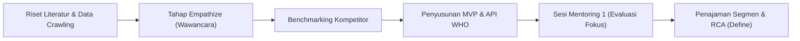
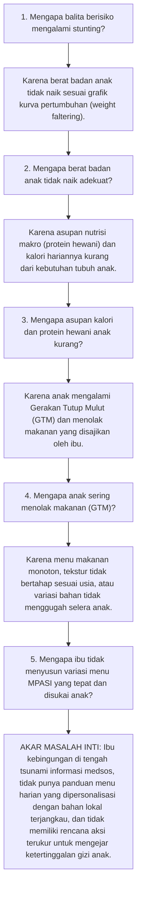

# Notulensi Resmi Mentoring Inkubasi BTP Batch 24 (Sesi 1)
## Program Inkubasi Startup Bandung Techno Park (Telkom University)
### Topik: Evaluasi Target Pengguna, Problem Validation, Analisis Kompetitor & Penajaman Solusi Stunting

---

<p align="center">
  
  
  
  
  
</p>

---

## 📌 Identitas & Metadata Berita Acara Mentoring

Berdasarkan dokumen resmi **Berita Acara Mentoring Program Inkubasi Tahun 2026 Bandung Techno Park**, berikut adalah ringkasan administratif sesi pendampingan perdana:

| Parameter | Keterangan Dokumen Resmi |
| :--- | :--- |
| **Program** | Program Inkubasi Startup Batch 24 Tahun 2026 |
| **Lembaga Penyelenggara** | **Bandung Techno Park (BTP)**, Telkom University |
| **Sesi Mentoring Ke-** | **1 (Satu) — Tahap Problem Validation & Customer Discovery** |
| **Hari, Tanggal** | **Kamis, 08 Oktober 2026** |
| **Nama Mentor** | **Wulan Fitriani** |
| **Nama Startup** | **Genystuntcare** |
| **Nama Produk / Platform** | **Geny StuntCare** ([genystuntcare.com](https://genystuntcare.com)) |
| **Pihak Mentee** | **Tim Genystuntcare** (Gerrard Sebastian & Tim) |
| **Tugas Sesi Sebelumnya** | *- (Sesi Perdana)* |
| **Status Berita Acara** | **Disetujui & Divalidasi oleh Mentee dan Mentor** |

### 📂 Berkas & Arsip Pendukung Terkait:
1. 📄 **Berita Acara Resmi BTP (PDF Asli):** [`Berita_Acara_Mentoring_01_Wulan_Fitriani_08Okt2026.pdf`](file:///Users/sinitygs/Projects21/mentoring/Berita_Acara_Mentoring_01_Wulan_Fitriani_08Okt2026.pdf) / [`Mentoring Genystuntcare.pdf`](file:///Users/sinitygs/Projects21/mentoring/Mentoring%20Genystuntcare.pdf)
2. 📘 **Materi Pelatihan BTP M1-L4 (Analyze Problems):** [`BAHASA_M1 - L4 Analyze Problems - Indonesian.pdf`](file:///Users/sinitygs/Projects21/mentoring/BAHASA_M1%20-%20L4%20Analyze%20Problems%20-%20Indonesian.pdf)
3. 🖼️ **Kerangka Kanvas BTP:** [`Kanvas Pernyataan Masalah.jpeg`](file:///Users/sinitygs/Projects21/mentoring/Kanvas%20Pernyataan%20Masalah.jpeg)
4. 📊 **Dokumen Riset Kompetitor Platform Parenting & Tumbuh Kembang:** [`competitor-analysis.md`](file:///Users/sinitygs/Projects21/competitor-analysis.md)

---

## 🧭 Ringkasan Eksekutif Sesi Mentoring

Pada sesi mentoring perdana ini, Mentor **Wulan Fitriani** mengapresiasi kerja keras dan arah awal tim Genystuntcare yang telah menjalankan riset literatur, wawancara pendahuluan, dan pengembangan MVP berbasis pendekatan *Design Thinking*. 

Namun, mentor memberikan catatan kritis yang sangat fundamental: **Target pengguna startup saat ini masih terlalu luas (*overly broad*) dan belum spesifik.** Tim berupaya mencakup calon pengantin (catin), ibu hamil, hingga ibu balita secara sekaligus. Akibatnya:
1. **Hasil validasi menjadi bias:** Calon pengantin merasa stunting belum menjadi masalah mereka, sementara sebagian ibu hamil yang sehat merasa kebutuhan medisnya sudah cukup terpenuhi oleh bidan atau dokter kandungan.
2. **Fokus produk berisiko terpecah (*lack of product-solution focus*):** Permintaan fitur yang terlalu banyak membuat tim kehilangan arah dalam menemukan masalah utama yang paling mendesak (*hair-on-fire problem*).

Mentor menegaskan agar tim **segera berhenti melebar, mengeliminasi segmen yang tidak mendesak, dan memusatkan seluruh daya validasi pada SATU segmen pengguna yang benar-benar memiliki penderitaan nyata (*bleeding neck problem*)**: yakni **Ibu dengan balita yang mengalami *underweight* (berat badan kurang / faltering), hampir stunting (garis kuning KMS), atau stunting**.

---

## 1. Kemajuan Startup (*Startup Progress*)

Berdasarkan evaluasi terhadap kemajuan tim hingga awal Oktober 2026:



1. **Pendekatan Design Thinking:** Tim berada pada transisi dari tahap **Empathize** menuju **Define** dalam merumuskan kebutuhan riil calon pengguna.
2. **Wawancara Lapangan Awal:** Tim telah melakukan wawancara penjajakan dengan beberapa kelompok narasumber (remaja/catin, ibu hamil, ibu balita, dan kader kesehatan).
3. **Riset Literatur & Saintifik yang Solid:** Tim telah mendokumentasikan temuan empiris melalui Paper Decision Tree CART (berbasis 304.193 balita SKI 2023), Buku Tugas Akhir Fuzzy Sugeno + Genetic Algorithm (160 halaman), telaah 102 halaman Consensus AI, dan sintesis determinan stunting (BBLR, sanitasi, kuintil ekonomi).
4. **Benchmarking Kompetitor Awal:** Tim telah memetakan lanskap kompetitor industri parenting digital (PrimaKu, Teman Bumil, Tentang Anak, dan Kinedu).
5. **Instrumen Validasi Lapangan:** Tim telah menyusun kuesioner dan pedoman wawancara 76 pertanyaan terstruktur untuk validasi mendalam.
6. **Kesiapan MVP Awal:** Tim telah memiliki purwarupa web ([genystuntcare.com](https://genystuntcare.com)) serta arsitektur RESTful API evaluasi standar Z-score WHO.

---

## 2. Masalah & Tantangan Utama yang Dihadapi

Hasil telaah mendalam bersama mentor mengidentifikasi 4 hambatan utama:

### A. Target Pengguna Masih Terlalu Luas (Catin, Ibu Hamil, Ibu Balita)
* **Kondisi:** Tim mencoba menyelesaikan seluruh rentang pencegahan 1000 Hari Pertama Kehidupan (HPK) sekaligus sejak masa pranikah hingga anak usia 2 tahun.
* **Dampak Negatif:** 
  * Calon pengantin (catin) menganggap pernikahan dan stunting masih jauh, sehingga tidak merasa butuh aplikasi pendamping gizi.
  * Ibu hamil dengan kondisi ekonomi stabil dan akses faskes memadai merasa pemantauan bidan sudah cukup.
  * Hasil riset lapangan menjadi bias dan tidak memberikan sinyal pasar yang tajam mengenai siapa yang bersedia mengadopsi platform secara rutin (*daily/weekly active users*).

### B. Kesulitan Menemukan Narasumber yang Benar-Benar Mengalami Masalah
* Tidak semua orang tua bersedia mengakui bahwa anaknya bermasalah gizi atau berpotensi stunting karena adanya **stigma sosial** dan rasa malu (*social desirability bias*).
* Wawancara dengan ibu balita sehat menghasilkan jawaban normatif (*"Semua baik-baik saja"*, *"Anak saya makannya gampang"*), yang tidak membuka celah perbaikan produk.

### C. Diferensiasi Solusi (*Value Proposition*) Belum Cukup Kuat
* Jika platform hanya menyediakan kalkulator tinggi badan (TB) dan berat badan (BB) digital, solusi ini telah disediakan oleh **PrimaKu** (yang bermitra resmi dengan Kemenkes & IDAI), **Tentang Anak**, dan **Buku KIA fisik**.
* Pengukuran di posyandu di lapangan rentan terhadap **human error dan technical error** (contoh: timbangan dacin di posyandu menunjukkan 10,0 kg, sementara timbangan digital di klinik swasta menunjukkan 10,3 kg). Sekadar mencatat angka tidak menyelesaikan akar kecemasan orang tua.

### D. Ancaman Kehilangan Fokus Akibat Banjir Permintaan Fitur (*Feature Creep*)
* Berbagai masukan eksternal menginginkan integrasi chatbot AI serba bisa, pelacak menstruasi promil, deteksi autisme anak, modul konsultasi psikologis, hingga sistem administrasi kader posyandu.
* Terlalu banyak fitur berisiko menguras sumber daya teknis sebelum tim membuktikan kesesuaian masalah dan solusi (*Problem-Solution Fit*).

---

## 3. Arahan & Rekomendasi Strategis Mentor (Wulan Fitriani)

Berikut adalah dekonstruksi 8 rekomendasi kunci dari mentor beserta penyesuaian relevansinya untuk proyek **Geny StuntCare**:

### 1. Menentukan Satu *Customer Segment* yang Sangat Spesifik (Fokus Tunggal)
* **Arahan Mentor:** Berhenti mengejar catin dan ibu hamil umum. Fokuskan seluruh energi validasi pada **Ibu dengan balita yang mengalami berat badan kurang (*underweight*), pertumbuhan melambat (*weight faltering*), atau berada di garis kuning/merah KMS (hampir stunting / stunting)**.
* **Relevansi & Persona Geny StuntCare:**
  * **Profil Ideal (Ideal Customer Profile - ICP):** Ibu muda / ibu bekerja melek teknologi (usia 23–35 tahun) dengan balita usia 6–24 bulan (fase krusial MPASI).
  * **Pain Point Nyata:** 
    * Anak mengalami **Gerakan Tutup Mulut (GTM)** parah atau susah makan kronis.
    * Kurva KMS posyandu mendatar atau turun 2 bulan berturut-turut (*weight faltering*).
    * Ibu frustrasi menyusun menu MPASI kaya protein hewani yang disukai anak, setelah berkali-kali mencoba resep internet namun gagal.
    * Ibu merasa cemas dan bersalah (*mom guilt*) menghadapi komentar lingkungan sekitar/keluarga.

### 2. Standar Metodologi Validasi Masalah (*Problem Validation Protocol*)
* **Jumlah Narasumber:** Minimal **15–20 orang** yang memiliki karakteristik masalah yang **serupa / homogen** (bukan sampel acak).
* **Format Pelaksanaan:** Diutamakan secara **tatap muka langsung (*offline*)** di lapangan agar pewawancara dapat melihat langsung kondisi fisik anak, interaksi saat makan, dan lingkungan dapur/sanitasi keluarga. Wawancara online dapat digunakan sebagai pelengkap.
* **Durasi & Format Pertanyaan:** 15–30 menit per sesi dengan **10–15 pertanyaan terbuka (*open-ended*)**.
* **Prinsip Utama (*Anti-Pitching*):** Gali penderitaan dan kebiasaan responden saat ini. **Dilarang keras mempresentasikan ide aplikasi atau menjual fitur di awal wawancara.**
* **Contoh Pertanyaan Validasi Rekomendasi Mentor:**
  1. *"Selama masa MPASI atau pertumbuhan anak, masalah apa yang paling membuat Ibu stres atau bingung?"*
  2. *"Kapan terakhir kali berat badan si kecil tidak naik, dan apa yang Ibu lakukan saat itu?"*
  3. *"Dari mana Ibu belajar menyusun menu makan anak? Apakah informasi tersebut mudah dipraktikkan?"*
  4. *"Kenapa Ibu merasa anak Ibu berisiko mengalami gangguan tumbuh kembang atau stunting?"*
  5. *"Usaha apa saja yang sudah Ibu coba untuk mengatasi anak susah makan, dan bagaimana hasilnya?"*
  6. *"Berapa banyak uang atau waktu yang sudah Ibu habiskan untuk mencari vitamin, suplemen, atau solusi tersebut?"*

### 3. Taktik Menjangkau Narasumber yang Tepat Tanpa Bias
Untuk mengatasi resistensi dan stigma masyarakat, terapkan 4 saluran rekrutmen:
1. **Jaringan Kader Posyandu & Bidan Desa:** Mintalah kader posyandu atau bidan yang sudah dikenal tim di wilayah riset Jawa Timur (Malang, Sidoarjo, Surabaya) untuk merekomendasikan ibu yang kurva KMS anaknya berada di garis kuning/merah.
2. **Infiltrasi Komunitas Parenting Media Sosial (Instagram/TikTok):** Masuk ke akun-akun edukasi gizi anak, dokter anak, dan MPASI. Cermati pengikut aktif dan kolom komentar yang mengeluhkan *"Anak saya BB seret"*, *"Anak saya GTM 2 minggu"*. Hubungi mereka secara personal untuk sesi wawancara mendalam.
3. **Survei *Screening* Terarah:** Buat kuesioner singkat dengan pertanyaan kualifikasi (*qualifier question*): *"Apakah berat badan anak Anda tidak naik dalam 2 bulan terakhir?"*, *"Apakah anak Anda sedang dalam fase susah makan?"*. Hanya tindak lanjuti responden yang memenuhi kriteria.
4. **Jaringan Pribadi & Akademisi:** Manfaatkan kontak dosen, relasi kampus Telkom University, dan tenaga kesehatan di lingkaran tim sebagai pintu masuk wawancara terpercaya.

### 4. Analisis Kompetitor & Perumusan Celah Solusi (*Value Proposition Gap*)
* Jangan menduplikasi fitur pencatatan standar. Pasar sudah memiliki pemain raksasa:
  * **PrimaKu:** Kuat di ekosistem kesehatan formal dan kemitraan IDAI/Kemenkes.
  * **Tentang Anak:** Kuat di ekosistem parenting lengkap, konsultasi dokter, dan AI skrining gejala awal.
  * **Teman Bumil:** Kuat di komunitas kehamilan dan promil.
  * **Kinedu:** Kuat di kurikulum aktivitas stimulasi harian terpersonalisasi berbasis langganan premium.
* **Diferensiasi Unik Geny StuntCare:**
  $$\mathbf{Diferensiasi} = \text{AI Prediksi Risiko} + \text{Data Kurva Pertumbuhan} + \mathbf{Personalized\ Action\ Plan\ (Menu\ MPASI\ \&\ Intervensi\ Terukur)}$$
  * Platform tidak hanya memberi label *"Anak Anda Berisiko Stunting"* (yang hanya menimbulkan kepanikan), melainkan menghadirkan **rencana aksi harian pemulihan gizi (*Catch-Up Growth Action Plan*)**: rekomendasi menu padat kalori berbahan pangan lokal terjangkau (telur, lele, hati ayam), tips stimulasi nafsu makan, dan jadwal evaluasi mingguan.
* **Pelajari Program Pemerintah:** 
  * Telusuri efektivitas program **Makan Bergizi Gratis (MBG)** dan program Pemberian Makanan Tambahan (PMT) lokal di puskesmas: mana yang dimakan anak dan mana yang terbuang?
  * Pelajari alur penanganan anak stunting di desa: jika balita terdeteksi di posyandu, ke mana kader melapor, bagaimana rujukan ke puskesmas/dokter spesialis anak, dan di mana titik kegagalan alurnya.

### 5. Kredibilitas Ilmiah & Kemitraan Medis
* Stunting adalah domain kesehatan berisiko tinggi (*high-stakes healthcare*). Pengguna dan pemerintah akan menuntut akuntabilitas: *"Siapa yang memvalidasi model AI dan saran nutrisi ini?"*
* **Kebutuhan Mendesak:** Tim wajib menggandeng **Dokter Spesialis Anak (Sp.A)** atau **Ahli Gizi (Nutrisionis/Dietisien)** sebagai *Medical Advisor* atau validator resmi algoritma.
* **Posisi Tenaga Kesehatan (Nakes & Kader):** Nakes di lapangan sudah kelelahan (*burnout*) mengisi berbagai aplikasi wajib pemerintah (e-PPGBM, ASIK, SatuSehat). **Jangan posisikan nakes sebagai pengguna yang wajib menginput data harian!** Posisikan mereka sebagai **validator eksternal, narasumber riset, dan pintu rujukan klinis.**

### 6. Strategi Menjalin Kemitraan Pemerintah (Dinas Kesehatan)
* Stunting merupakan program prioritas nasional dengan alokasi anggaran dan perhatian besar.
* **Sikap Saat Bertemu Dinas Kesehatan (misal Dinkes Jatim):** Jangan datang membawa presentasi *"Kami punya aplikasi hebat"*. Datanglah dengan kerendahan hati untuk **mendengarkan kendala program stunting daerah mereka**, memahami laporan apa yang mandek, dan mencari tahu program mana yang tidak efektif.
* Jika tim berhasil menunjukkan bahwa Geny StuntCare membantu menyelesaikan *bottleneck* intervensi gizi di level keluarga, peluang kerja sama resmi dan replikasi antar-kabupaten akan terbuka lebar.

### 7. Validasi Geografis Bebas Asumsi
* Asumsi bahwa *"ibu di desa pasti beda perilaku dengan ibu di kota"* atau *"kondisi Jawa Timur berbeda dengan Jawa Barat"* tidak boleh disimpulkan dari 1 narasumber.
* Jika ingin menarik kesimpulan disparitas wilayah, kumpulkan minimal 10 narasumber per kategori wilayah dengan instrumen yang terstandar.

### 8. Ketegasan Menolak Fitur yang Belum Terbukti (*Saying NO to Feature Creep*)
* **Prinsip Utama:** Tidak semua permintaan calon pengguna harus diimplementasikan.
* Fokus tim pada Stage 1 Inkubasi BTP adalah **Problem Validation** dan **Problem-Solution Fit**, bukan memperbanyak fitur. Setiap fitur yang tidak langsung menyelesaikan masalah kenaikan berat badan balita harus ditunda.

---

## 4. Pengisian Kanvas Pernyataan Masalah (*Problem Statement Canvas*)

Sesuai materi resmi **BTP Module 1 Lesson 4: Analyze Problems**, tim menuangkan hasil sintesis mentoring ke dalam 6 kuadran Kanvas Pernyataan Masalah:

```
┌─────────────────────────────────────────────────────────────────────────────────────────────┐
│                             KANVAS PERNYATAAN MASALAH (BTP 2026)                            │
├──────────────────────────────────────────────┬──────────────────────────────────────────────┤
│ 01. MASALAH (The Core Problem)               │ 01. KONSUMEN / PENGGUNA (The Core Persona)   │
│ Balita usia 6–24 bulan mengalami gagal       │ Ibu muda / ibu bekerja melek digital         │
│ tumbuh (weight faltering / underweight)      │ (usia 23–35 tahun, SES Menengah ke Bawah     │
│ akibat GTM berkepanjangan dan ketidaktahuan  │ & Menengah) yang memiliki anak dengan kurva  │
│ ibu menyusun MPASI bernutrisi tinggi, yang   │ KMS mendatar/menurun. Estimasi populasi:     │
│ berisiko permanen menjadi stunting.          │ ~3,5–4 Juta keluarga balita di Indonesia.    │
├──────────────────────────────────────────────┼──────────────────────────────────────────────┤
│ 02. FREKUENSI (Occurrence Rate)              │ 02. PENYEBAB UTAMA & DAMPAK (RCA & Impact)   │
│ Terjadi setiap hari secara repetitif saat    │ Penyebab: Informasi MPASI berseliweran &     │
│ jam makan anak (3x makan utama + 2x selingan)│ tidak personal; anak menolak tekstur/rasa;   │
│ dan dievaluasi setiap 1 bulan sekali saat    │ keterbatasan waktu memasak menu variatif.    │
│ jadwal penimbangan Posyandu.                 │ Dampak: Stres berat & rasa bersalah pada ibu;│
│                                              │ anak berisiko stunting permanen & otak drop. │
├──────────────────────────────────────────────┼──────────────────────────────────────────────┤
│ 03. SOLUSI SAAT INI (Current Alternatives)   │ 03. KESESUAIAN SAYA (Founder-Problem Fit)    │
│ - Menonton video TikTok/IG resep acak        │ - Tim memiliki keahlian Data Science & AI    │
│ - Bertanya di grup WhatsApp parenting        │   (Paper Decision Tree CART & Sistem Fuzzy)  │
│ - Membeli vitamin penambah nafsu makan tanpa │ - Memiliki platform MVP awal (genystuntcare) │
│   resep dokter                               │ - Didukung jejaring riset Telkom University  │
│ - Pasrah menunggu jadwal posyandu bulan depan│   dan aliansi fasilitas kesehatan (Yakes).   │
└──────────────────────────────────────────────┴──────────────────────────────────────────────┘
```

---

## 5. Analisis Akar Masalah (Root Cause Analysis - RCA 5-Why)

Penerapan metode **5-Why** sesuai modul pembelajaran BTP:



---

## 6. Matriks Perbandingan Kompetitor & Celah Solusi

| Parameter Evaluasi | PrimaKu | Teman Bumil | Tentang Anak | Kinedu | **Geny StuntCare (Target Posisi)** |
| :--- | :---: | :---: | :---: | :---: | :---: |
| **Fokus Utama** | Tumbuh kembang & ekosistem medis | Komunitas kehamilan & promil | Perkembangan anak & asistensi AI | Stimulasi perkembangan balita | **Pencegahan Stunting & Intervensi Nutrisi Presisi** |
| **Target Pengguna** | Orang tua umum & dokter anak | Ibu hamil & pasangan baru | Orang tua anak usia dini | Orang tua & pengasuh | **Ibu dengan balita faltering/underweight/stunting** |
| **KMS Digital & Kurva WHO** | Sangat Lengkap (Mitra IDAI) | Cukup | Lengkap | Dasar | **Lengkap + Evaluasi Z-Score Terotomasi** |
| **Peringatan Dini Malnutrisi** | Grafik kurva visual | Edukasi artikel | Skrining kuesioner | Tidak fokus stunting | **Deteksi Dini Prediktif AI (CART Decision Tree)** |
| **Personalisasi Rencana Aksi Menu** | Terbatas (Artikel resep) | Terbatas (Resep umum) | Rekomendasi umum | Sangat personal (Aktivitas) | **Sangat Personal (Menu MPASI lokal padat kalori)** |
| **Model Aksesibilitas** | Freemium | Gratis + Iklan / Toko | Freemium | Berlangganan Berbayar | **Freemium Terjangkau / Kemitraan CSR & Pemda** |
| **Beban Input untuk Nakes** | Tinggi jika terhubung klinik | Rendah (Khusus user) | Rendah (Khusus user) | Khusus orang tua | **Nol Beban Harian (Nakes hanya sebagai validator)** |

---

## 7. Tugas & Rencana Aksi (*Action Plan*) untuk Sesi Selanjutnya

Berdasarkan kesepakatan resmi dalam Berita Acara Mentoring BTP, tim berkomitmen mengeksekusi 5 rencana aksi utama:

| No | Rencana Aksi (*Task Item*) | Rincian Eksekusi & Metodologi | Target Output (*Deliverables*) |
| :---: | :--- | :--- | :--- |
| **1** | **Memilih Segmen & Menyusun Persona** | Memusatkan segmen pada Ibu Balita dengan anak *underweight* / *weight faltering*. Menyusun profil persona rinci (demografi, kendala harian, ketakutan terbesar, saluran media). | 1 Dokumen Persona Inti (*Buyer/User Persona Canvas*) yang disepakati seluruh tim. |
| **2** | **Menentukan Kriteria Screening Narasumber** | Merumuskan kriteria inklusi ketat untuk menjaring responden wawancara: (a) Punya anak usia 6–24 bulan, (b) Berat badan stagnan/turun minimal 2 bulan berturut-turut, (c) Mengalami GTM kronis. | Kuesioner screening singkat (*Google Form / WhatsApp Form*) dengan 4 pertanyaan kualifikasi. |
| **3** | **Menulis Hipotesis Masalah Utama** | Merumuskan hipotesis yang dapat diuji (*testable & falsifiable*), misalnya: *"Ibu mengalami kebingungan menentukan menu MPASI padat kalori lokal sehingga anak mengalami berat badan seret."* | Matriks hipotesis masalah vs indikator validasi lapangan. |
| **4** | **Riset Program Pemerintah & Alur Desa** | Melakukan telaah terhadap program Makan Bergizi Gratis (MBG), program PMT lokal Puskesmas, dan memetakan alur eskalasi rujukan penanganan balita stunting di desa Jawa Timur. | Dokumen pemetaan alur rujukan stunting & telaah celah program pemerintah. |
| **5** | **Melaksanakan Wawancara & Merangkum Temuan** | Menjalankan minimal 15–20 wawancara mendalam (offline/online) bebas bias menggunakan instrumen 10–15 pertanyaan terbuka. Merekap temuan pain points dan pola perilaku. | Transkrip dan matriks rekapitulasi tematik 15–20 narasumber terverifikasi. |

---

## ✍️ Pengesahan Dokumen Mentoring

Dokumen ini disusun dan diperbarui berdasarkan Berita Acara Mentoring Program Inkubasi Tahun 2026 Bandung Techno Park yang telah ditandatangani oleh:

<table style="width: 100%; border: none;">
  <tr>
    <td style="width: 50%; text-align: center; border: none;">
      <p><strong>Pihak Mentee,</strong></p>
      <br /><br />
      <p><u><strong>Tim Genystuntcare</strong></u><br />
      Perwakilan Tim Inkubasi BTP Batch 24</p>
    </td>
    <td style="width: 50%; text-align: center; border: none;">
      <p><strong>Pihak Mentor,</strong></p>
      <br /><br />
      <p><u><strong>Wulan Fitriani</strong></u><br />
      Mentor Program Inkubasi Bandung Techno Park</p>
    </td>
  </tr>
</table>

---

<p align="center">
  <em>Dokumentasi resmi ini terintegrasi langsung dengan Repositori Projects21 / Inkubasi-Startup-BTP : Bandung Techno Park (Telkom University).</em>
</p>
