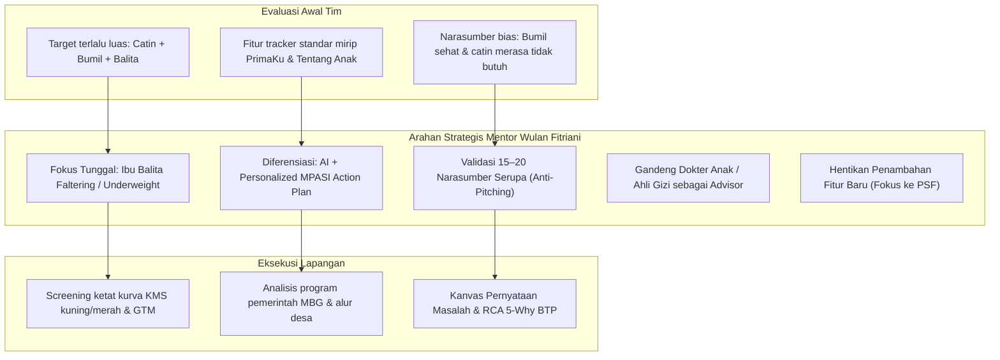

# Folder Mentoring : Bimbingan & Konsultasi Startup BTP Batch 24
### Dokumentasi Resmi Sesi Mentoring 1-on-1 Bersama Mentor Inkubasi Bandung Techno Park (Telkom University)

---

<p align="center">
  
  
  
  
</p>

---

## 📖 Tentang Direktori Mentoring

Folder khusus ini menghimpun seluruh dokumen berita acara, notulensi mendalam, transkrip arahan strategis, kerangka analisis masalah, dan rencana aksi (*action plan*) dari setiap sesi **Mentoring 1-on-1** yang diselenggarakan oleh **Bandung Techno Park (BTP)** untuk tim startup **Genystuntcare** ([genystuntcare.com](https://genystuntcare.com)).

Berbeda dengan sesi *Workshop* umum yang membawakan materi masterclass kepada seluruh peserta batch, sesi *Mentoring* bersifat konsultasi langsung dan evaluasi kritis mendalam terhadap eksekusi riil produk, validasi pasar, dan arsitektur bisnis startup di lapangan.

---

## 🗺️ Struktur Direktori Mentoring:

```
mentoring/
├── README.md                                          # Hub navigasi & rekapitulasi seluruh sesi mentoring (Dokumen ini)
├── 8-Oktober-2026.md                                  # Notulensi LENGKAP & Berita Acara Sesi 1 (Wulan Fitriani)
├── Berita_Acara_Mentoring_01_Wulan_Fitriani_08Okt2026.pdf # Arsip PDF resmi Berita Acara Mentoring Sesi 1 (Halaman 1–2)
├── Mentoring Genystuntcare.pdf                         # Salinan file PDF Berita Acara Mentoring
├── BAHASA_M1 - L4 Analyze Problems - Indonesian.pdf   # Materi Pelatihan BTP Module 1 Lesson 4: Analyze Problems
└── Kanvas Pernyataan Masalah.jpeg                     # Format visual Kanvas Pernyataan Masalah resmi BTP
```

---

## 📊 Rekapitulasi Rangkaian Sesi Mentoring BTP 2026:

| Sesi | Hari & Tanggal | Nama Mentor | Topik Fokus Diskusi | Status Dokumentasi | Berkas Berita Acara | Tautan Notulensi |
| :---: | :---: | :--- | :--- | :---: | :---: | :--- |
| **Mentoring 1** | **Kamis, 08 Oktober 2026** | **Wulan Fitriani** | **Evaluasi Target User, Penajaman Segmen Ibu Balita Underweight, Metodologi Validasi Masalah, Analisis Kompetitor & Pengendalian Fitur** | **Lengkap & Terverifikasi** | [Unduh PDF Berita Acara](file:///Users/sinitygs/Projects21/mentoring/Berita_Acara_Mentoring_01_Wulan_Fitriani_08Okt2026.pdf) | [Buka Notulensi Sesi 1](file:///Users/sinitygs/Projects21/mentoring/8-Oktober-2026.md) |
| **Mentoring 2** | *Upcoming* | *Akan Diumumkan* | *Evaluasi Hasil Wawancara 15–20 Ibu Balita & Formulasi Problem-Solution Fit* | *Menunggu Jadwal* | — | — |
| **Mentoring 3** | *Upcoming* | *Akan Diumumkan* | *Validasi Solusi, Uji Prototipe MVP & Value Proposition Canvas* | *Menunggu Jadwal* | — | — |

---

## 💡 Intisari Pilar Strategis dari Mentoring Sesi 1 (Wulan Fitriani):



1. **Penajaman Segmen (Stop Melebar):**  
   Fokus mutlak pada satu target persona yang merasakan penderitaan akut: **Ibu muda dengan anak usia 6–24 bulan yang mengalami *weight faltering* (kenaikan BB tidak adekuat), susah makan (GTM kronis), atau berada di garis kuning/merah KMS**.
2. **Kualitas Validasi Masalah:**  
   Melaksanakan 15–20 wawancara mendalam bebas bias (*The Mom Test*) tanpa mempresentasikan solusi, melalui rujukan kader posyandu dan komunitas parenting media sosial.
3. **Celah Diferensiasi Solusi:**  
   Bukan sekadar pencatatan KMS digital, melainkan **panduan rencana aksi nutrisi harian yang dipersonalisasi (*Personalized Nutrition Action Plan*)** berbasis bahan pangan lokal terjangkau.
4. **Kredibilitas Medis:**  
   Melibatkan dokter spesialis anak (Sp.A) dan nutrisionis sebagai dewan penasihat (*advisory board*) resmi.
5. **Fokus Problem-Solution Fit:**  
   Tegas menolak *feature creep* dan berkonsentrasi membuktikan apakah solusi yang ditawarkan menyelesaikan penderitaan utama ibu balita.

---

<p align="center">
  <em>Dipersiapkan untuk Program Inkubasi Startup Batch 24 : Bandung Techno Park (Telkom University).</em>
</p>
